# 🖼️ Katalog Tangkapan Layar Penuh (Long Image) — SkillBridge Rework

Dokumen ini memuat daftar lengkap hasil ekspor visual **seluruh 22 antarmuka web (HTML Pages)** sistem **SkillBridge Rework** dalam resolusi tinggi (*High-DPI Retina*) berformat **Long Image (Full-Page Screenshot)**.

> **Spesifikasi Tangkapan Layar:**
> - **Resolusi Lebar:** 1440px (Standar Widescreen Desktop)
> - **Device Scale Factor:** 1.5x (Super Sharp Retina Quality)
> - **Format Berkas:** PNG Lossless 24-bit
> - **Total Halaman:** 22 Halaman Lengkap

---

## 📋 Tabel Inventaris Seluruh Halaman Antarmuka

| No | Berkas Gambar | Judul Halaman | Kategori | Peran Akun | Dimensi (Px) | Ukuran |
| :---: | :--- | :--- | :--- | :---: | :---: | :---: |
| **1** | [`01_landing_page.png`](./01_landing_page.png) | **Landing Page (Home)** | Public & Beranda | `GUEST` | 1440 × 3516 | 1358 KB |
| **2** | [`02_auth_login.png`](./02_auth_login.png) | **Halaman Masuk (Login)** | Autentikasi | `GUEST` | 1440 × 900 | 100 KB |
| **3** | [`03_auth_register.png`](./03_auth_register.png) | **Halaman Pendaftaran (Register)** | Autentikasi | `GUEST` | 1440 × 1120 | 118 KB |
| **4** | [`04_projects_market.png`](./04_projects_market.png) | **Eksplorasi Proyek (Marketplace)** | Katalog & Eksplorasi | `MAHASISWA` | 1440 × 1468 | 336 KB |
| **5** | [`05_project_detail.png`](./05_project_detail.png) | **Detail Proyek & Analisis AI Matchmaker** | Katalog & Eksplorasi | `MAHASISWA` | 1440 × 933 | 197 KB |
| **6** | [`06_student_dashboard.png`](./06_student_dashboard.png) | **Dashboard Mahasiswa** | Portal Mahasiswa | `MAHASISWA` | 1440 × 1311 | 244 KB |
| **7** | [`07_student_my_projects.png`](./07_student_my_projects.png) | **Proyek Saya (Student My Projects)** | Portal Mahasiswa | `MAHASISWA` | 1440 × 1427 | 226 KB |
| **8** | [`08_student_workspace.png`](./08_student_workspace.png) | **Ruang Kerja Kolaborasi & Obrolan Real-Time** | Portal Mahasiswa | `MAHASISWA` | 1440 × 1096 | 226 KB |
| **9** | [`09_student_profile.png`](./09_student_profile.png) | **Profil & Portofolio Mahasiswa** | Portal Mahasiswa | `MAHASISWA` | 1440 × 1139 | 285 KB |
| **10** | [`10_umkm_dashboard.png`](./10_umkm_dashboard.png) | **Dashboard Mitra UMKM** | Portal UMKM | `UMKM` | 1440 × 1127 | 183 KB |
| **11** | [`11_umkm_my_projects.png`](./11_umkm_my_projects.png) | **Kelola Proyek UMKM (My Projects)** | Portal UMKM | `UMKM` | 1440 × 1279 | 229 KB |
| **12** | [`12_umkm_create_project.png`](./12_umkm_create_project.png) | **Formulir Publikasi Proyek & AI Brief Synthesizer** | Portal UMKM | `UMKM` | 1440 × 976 | 192 KB |
| **13** | [`13_umkm_applicants.png`](./13_umkm_applicants.png) | **Review Pelamar & Peringkat AI Matchmaking** | Portal UMKM | `UMKM` | 1440 × 1850 | 338 KB |
| **14** | [`14_umkm_talent_search.png`](./14_umkm_talent_search.png) | **Pencarian Direktori Talenta Mahasiswa** | Portal UMKM | `UMKM` | 1440 × 1448 | 207 KB |
| **15** | [`15_umkm_profile.png`](./15_umkm_profile.png) | **Profil Bisnis & Gerai UMKM** | Portal UMKM | `UMKM` | 1440 × 1150 | 301 KB |
| **16** | [`16_umkm_settings.png`](./16_umkm_settings.png) | **Pengaturan Akun & Keamanan UMKM** | Portal UMKM | `UMKM` | 1440 × 900 | 161 KB |
| **17** | [`17_admin_dashboard.png`](./17_admin_dashboard.png) | **Dashboard Administrator & Metrik Sistem** | Portal Administrator | `ADMIN` | 1440 × 900 | 108 KB |
| **18** | [`18_admin_users.png`](./18_admin_users.png) | **Manajemen Pengguna (Admin Users)** | Portal Administrator | `ADMIN` | 1440 × 1413 | 284 KB |
| **19** | [`19_admin_projects.png`](./19_admin_projects.png) | **Manajemen Proyek Listing (Admin Projects)** | Portal Administrator | `ADMIN` | 1440 × 900 | 206 KB |
| **20** | [`20_admin_verification.png`](./20_admin_verification.png) | **Verifikasi Dokumen Akademik & Legalitas NIB** | Portal Administrator | `ADMIN` | 1440 × 1036 | 196 KB |
| **21** | [`21_admin_categories.png`](./21_admin_categories.png) | **Manajemen Kategori Transformasi Digital** | Portal Administrator | `ADMIN` | 1440 × 1083 | 172 KB |
| **22** | [`22_admin_matching.png`](./22_admin_matching.png) | **Monitoring Log & Kompatibilitas AI Matchmaking** | Portal Administrator | `ADMIN` | 1440 × 2892 | 627 KB |

---

## 🔍 Ringkasan Deskripsi & Fitur Per Halaman

### 1. Landing Page (Home)
- **Nama Berkas:** `01_landing_page.png`
- **Kategori:** Public & Beranda | **Peran Diuji:** `GUEST`
- **Dimensi Tangkapan:** 1440 × 3516 px (1358 KB)
- **Tautan Halaman Sumber:** [`/index.html`](../frontend/index.html)
- **Deskripsi Antarmuka:** Halaman beranda utama publik dengan hero banner, value proposition, katalog proyek unggulan, FAQ interaktif, dan formulir kontak.

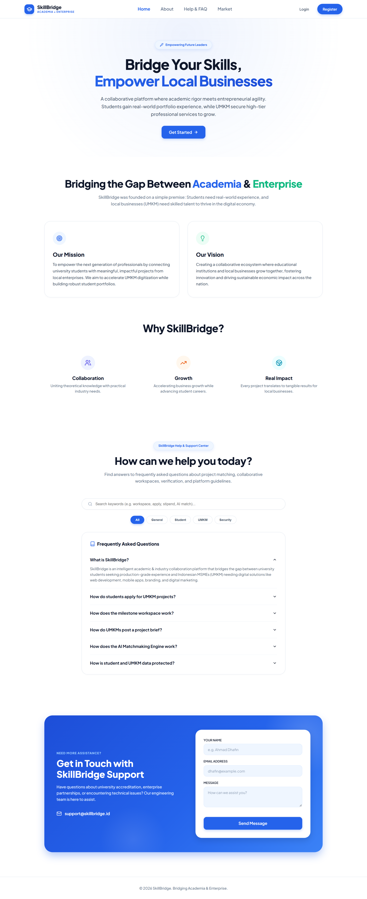

---

### 2. Halaman Masuk (Login)
- **Nama Berkas:** `02_auth_login.png`
- **Kategori:** Autentikasi | **Peran Diuji:** `GUEST`
- **Dimensi Tangkapan:** 1440 × 900 px (100 KB)
- **Tautan Halaman Sumber:** [`/pages/auth/login.html`](../frontend/pages/auth/login.html)
- **Deskripsi Antarmuka:** Formulir autentikasi masuk multi-peran (Mahasiswa, UMKM, Admin) dengan validasi kredensial dan tombol demo quick-login.

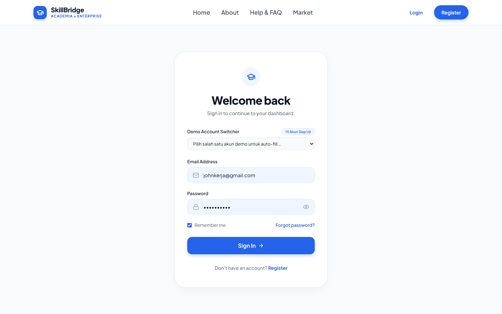

---

### 3. Halaman Pendaftaran (Register)
- **Nama Berkas:** `03_auth_register.png`
- **Kategori:** Autentikasi | **Peran Diuji:** `GUEST`
- **Dimensi Tangkapan:** 1440 × 1120 px (118 KB)
- **Tautan Halaman Sumber:** [`/pages/auth/register.html`](../frontend/pages/auth/register.html)
- **Deskripsi Antarmuka:** Formulir pendaftaran akun baru dengan pemilihan peran dinamis, validasi email kampus .ac.id, dan profil usaha UMKM.

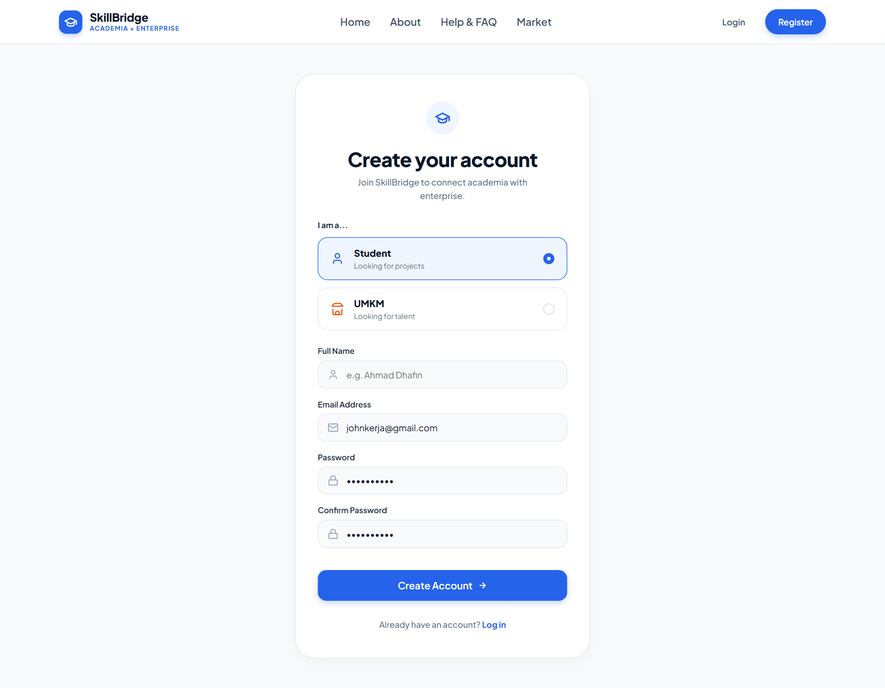

---

### 4. Eksplorasi Proyek (Marketplace)
- **Nama Berkas:** `04_projects_market.png`
- **Kategori:** Katalog & Eksplorasi | **Peran Diuji:** `MAHASISWA`
- **Dimensi Tangkapan:** 1440 × 1468 px (336 KB)
- **Tautan Halaman Sumber:** [`/pages/projects.html`](../frontend/pages/projects.html)
- **Deskripsi Antarmuka:** Pusat eksplorasi proyek digital UMKM dengan filter kategori, rentang stipend/budget, pencarian kata kunci, dan kartu status listing.

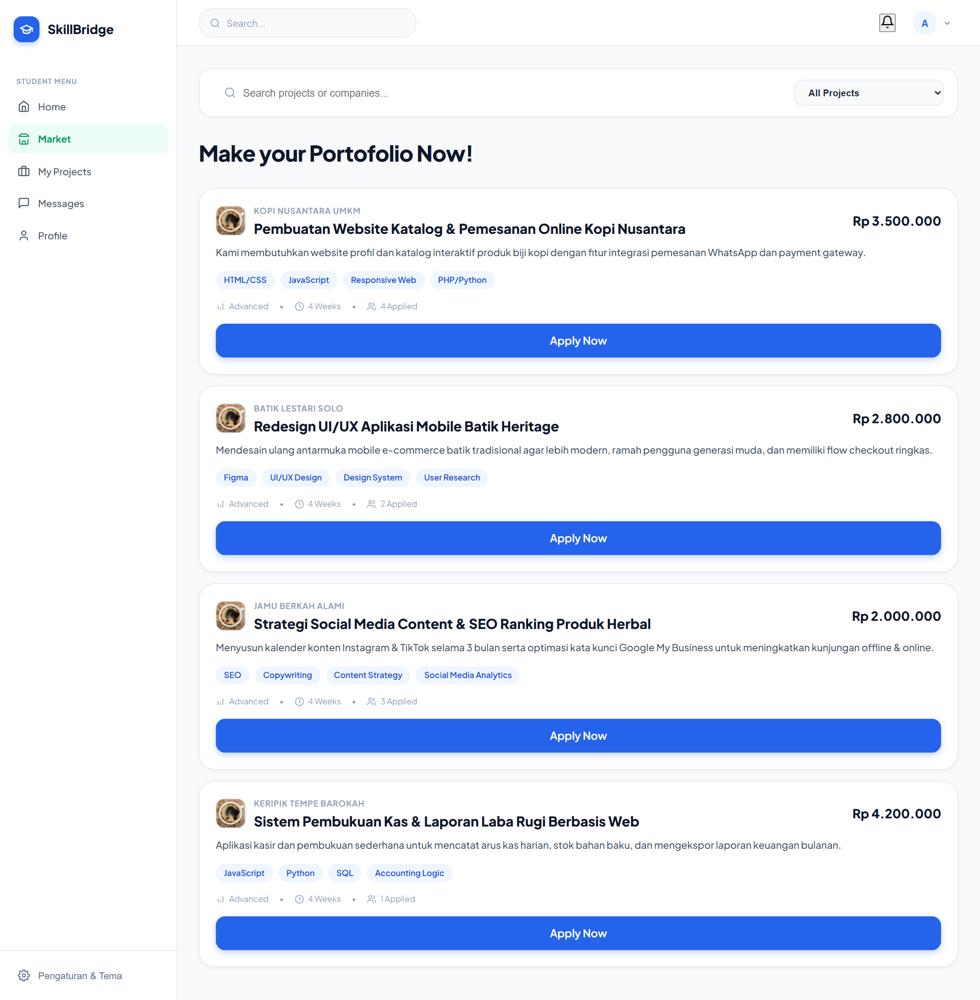

---

### 5. Detail Proyek & Analisis AI Matchmaker
- **Nama Berkas:** `05_project_detail.png`
- **Kategori:** Katalog & Eksplorasi | **Peran Diuji:** `MAHASISWA`
- **Dimensi Tangkapan:** 1440 × 933 px (197 KB)
- **Tautan Halaman Sumber:** [`/pages/project-detail.html?id=p1`](../frontend/pages/project-detail.html?id=p1)
- **Deskripsi Antarmuka:** Detail komprehensif ruang lingkup proyek, profil mitra UMKM, tombol pelamaran kilat, serta modul inferensi AI Gemini Matchmaker.

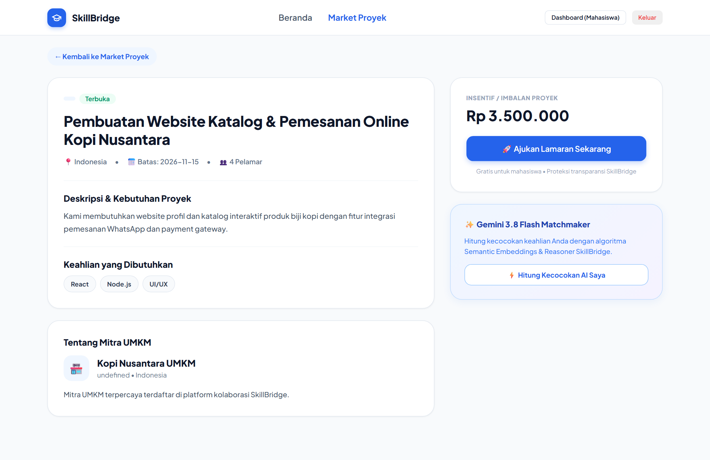

---

### 6. Dashboard Mahasiswa
- **Nama Berkas:** `06_student_dashboard.png`
- **Kategori:** Portal Mahasiswa | **Peran Diuji:** `MAHASISWA`
- **Dimensi Tangkapan:** 1440 × 1311 px (244 KB)
- **Tautan Halaman Sumber:** [`/pages/student/dashboard.html`](../frontend/pages/student/dashboard.html)
- **Deskripsi Antarmuka:** Ringkasan akademik talenta dengan skor portofolio, grafik linier aktivitas mingguan kustom, metrik proyek aktif, dan daftar pengerjaan berjalan.

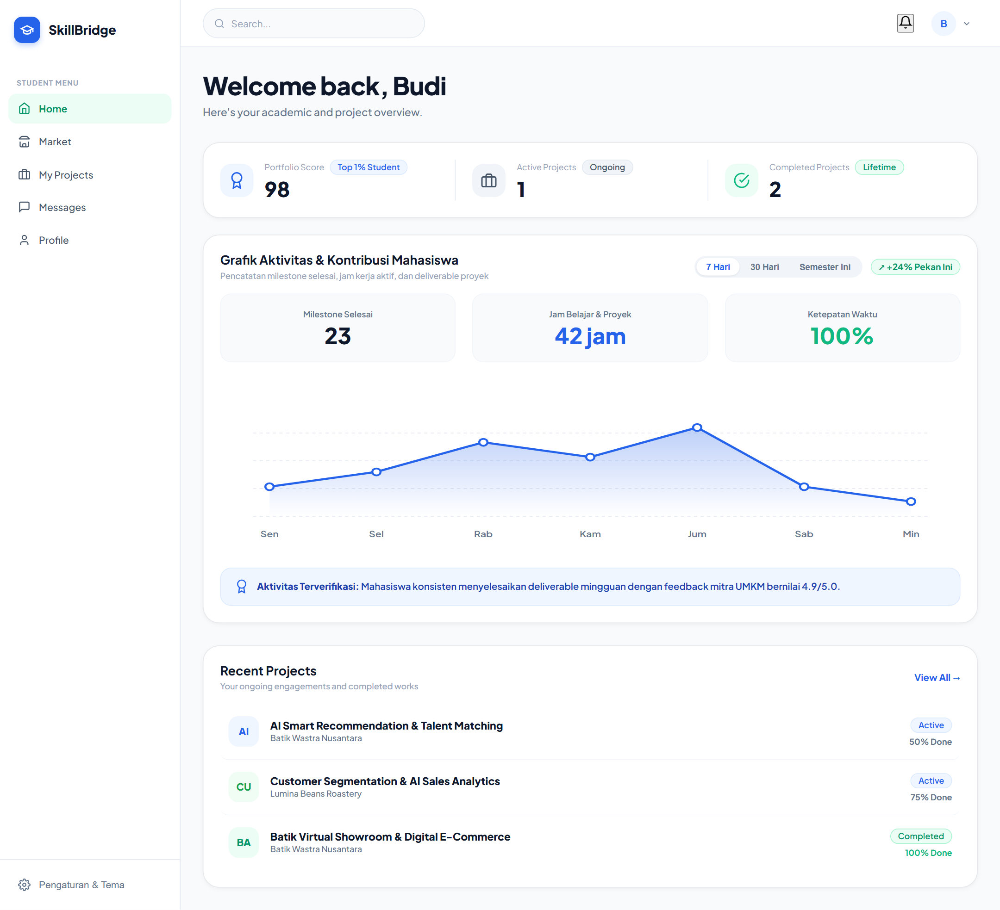

---

### 7. Proyek Saya (Student My Projects)
- **Nama Berkas:** `07_student_my_projects.png`
- **Kategori:** Portal Mahasiswa | **Peran Diuji:** `MAHASISWA`
- **Dimensi Tangkapan:** 1440 × 1427 px (226 KB)
- **Tautan Halaman Sumber:** [`/pages/student/my-projects.html`](../frontend/pages/student/my-projects.html)
- **Deskripsi Antarmuka:** Daftar riwayat lamaran dan keterlibatan proyek mahasiswa terfilter berdasarkan status (Semua, Aktif, Menunggu, Selesai).

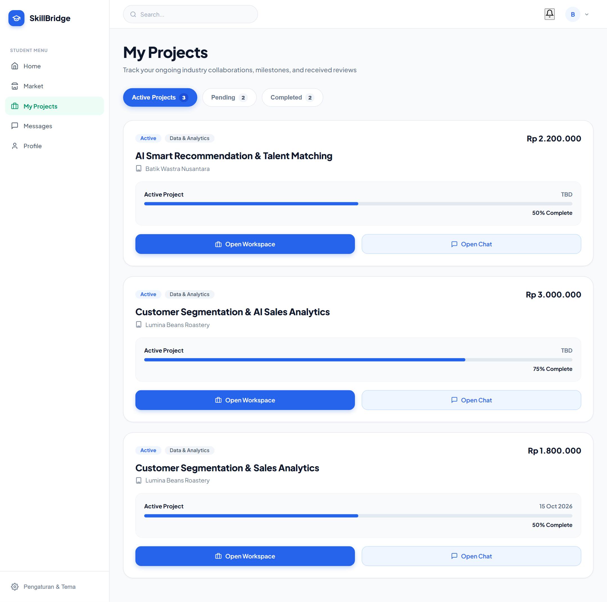

---

### 8. Ruang Kerja Kolaborasi & Obrolan Real-Time
- **Nama Berkas:** `08_student_workspace.png`
- **Kategori:** Portal Mahasiswa | **Peran Diuji:** `MAHASISWA`
- **Dimensi Tangkapan:** 1440 × 1096 px (226 KB)
- **Tautan Halaman Sumber:** [`/pages/student/workspace.html?project_id=p1`](../frontend/pages/student/workspace.html?project_id=p1)
- **Deskripsi Antarmuka:** Ruang kerja kolaboratif interaktif dengan pelacak progres, checklist milestone, pengunggahan tautan hasil kerja, dan drawer obrolan instan.

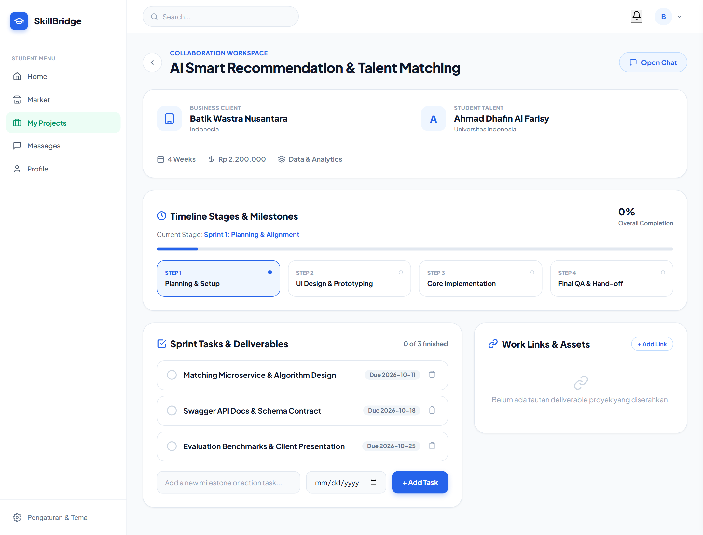

---

### 9. Profil & Portofolio Mahasiswa
- **Nama Berkas:** `09_student_profile.png`
- **Kategori:** Portal Mahasiswa | **Peran Diuji:** `MAHASISWA`
- **Dimensi Tangkapan:** 1440 × 1139 px (285 KB)
- **Tautan Halaman Sumber:** [`/pages/student/profile.html`](../frontend/pages/student/profile.html)
- **Deskripsi Antarmuka:** Halaman profil publik talenta digital dengan kredensial universitas, badge keahlian terverifikasi, sertifikat, dan review endorsement UMKM.

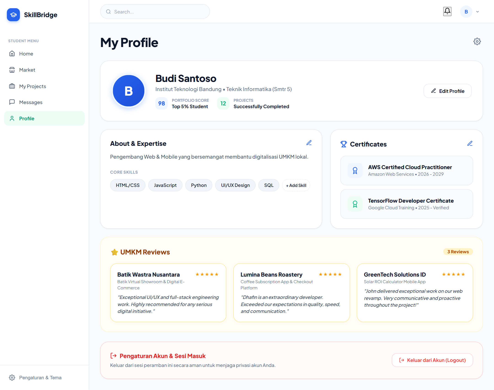

---

### 10. Dashboard Mitra UMKM
- **Nama Berkas:** `10_umkm_dashboard.png`
- **Kategori:** Portal UMKM | **Peran Diuji:** `UMKM`
- **Dimensi Tangkapan:** 1440 × 1127 px (183 KB)
- **Tautan Halaman Sumber:** [`/pages/umkm/dashboard.html`](../frontend/pages/umkm/dashboard.html)
- **Deskripsi Antarmuka:** Pusat komando mitra usaha dengan metrik proyek aktif, total pelamar masuk, shortcut publikasi proyek AI, dan notifikasi aktivitas terbaru.

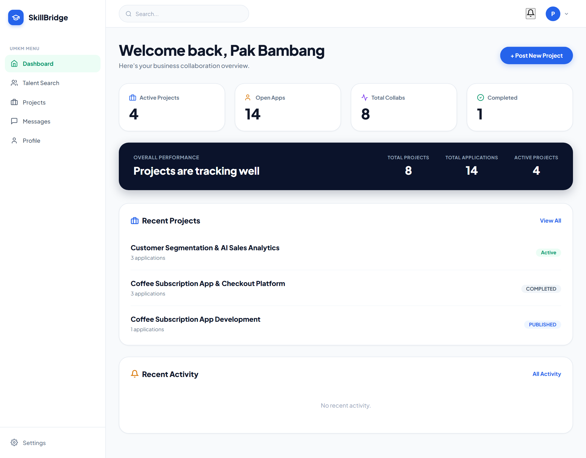

---

### 11. Kelola Proyek UMKM (My Projects)
- **Nama Berkas:** `11_umkm_my_projects.png`
- **Kategori:** Portal UMKM | **Peran Diuji:** `UMKM`
- **Dimensi Tangkapan:** 1440 × 1279 px (229 KB)
- **Tautan Halaman Sumber:** [`/pages/umkm/my-projects.html`](../frontend/pages/umkm/my-projects.html)
- **Deskripsi Antarmuka:** Manajemen seluruh listing proyek usaha mikro dengan indikator status, jumlah pelamar, tombol review, dan kontrol status publikasi.

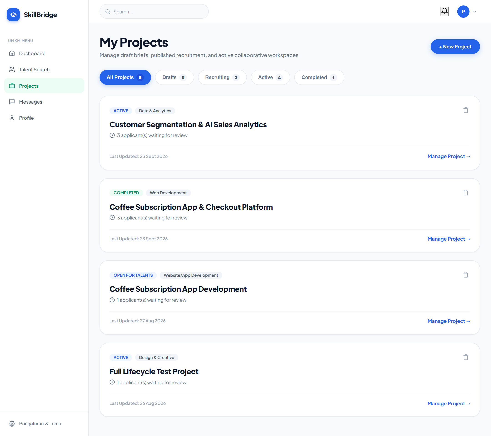

---

### 12. Formulir Publikasi Proyek & AI Brief Synthesizer
- **Nama Berkas:** `12_umkm_create_project.png`
- **Kategori:** Portal UMKM | **Peran Diuji:** `UMKM`
- **Dimensi Tangkapan:** 1440 × 976 px (192 KB)
- **Tautan Halaman Sumber:** [`/pages/umkm/create-project.html`](../frontend/pages/umkm/create-project.html)
- **Deskripsi Antarmuka:** Pembuat proyek pintar dengan input keluhan bahasa sehari-hari dan tombol sintesis otomatis AI Gemini Flash menjadi brief formal.

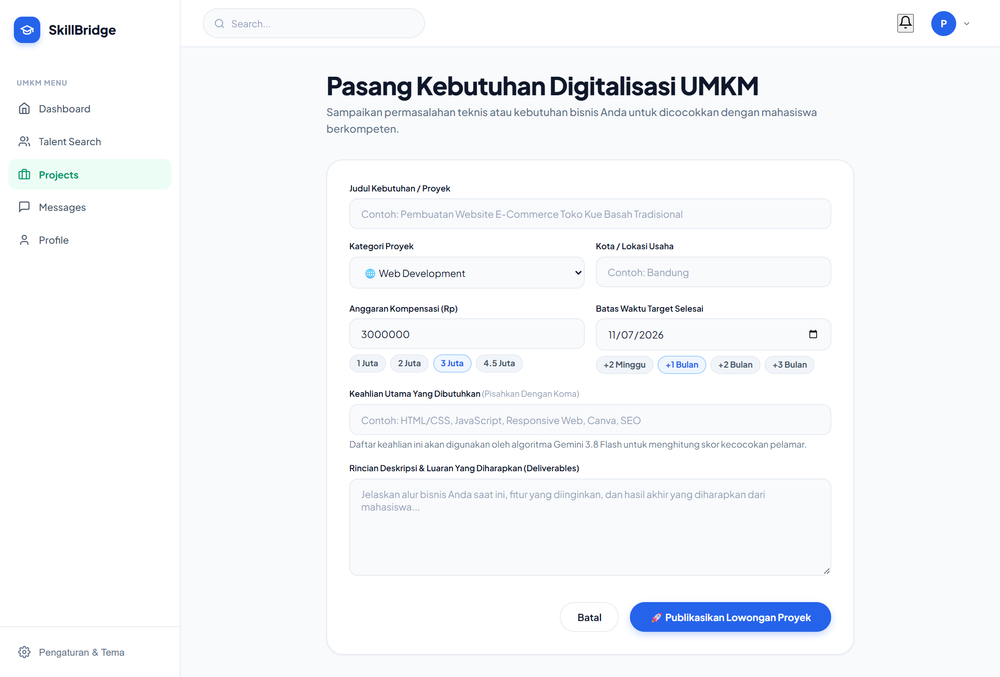

---

### 13. Review Pelamar & Peringkat AI Matchmaking
- **Nama Berkas:** `13_umkm_applicants.png`
- **Kategori:** Portal UMKM | **Peran Diuji:** `UMKM`
- **Dimensi Tangkapan:** 1440 × 1850 px (338 KB)
- **Tautan Halaman Sumber:** [`/pages/umkm/applicants.html?project_id=p1`](../frontend/pages/umkm/applicants.html?project_id=p1)
- **Deskripsi Antarmuka:** Daftar kandidat pelamar mahasiswa berperingkat skor AI (60-99%) dengan analisis pertimbangan teknis, portofolio, dan tombol keputusan [Accept/Reject].

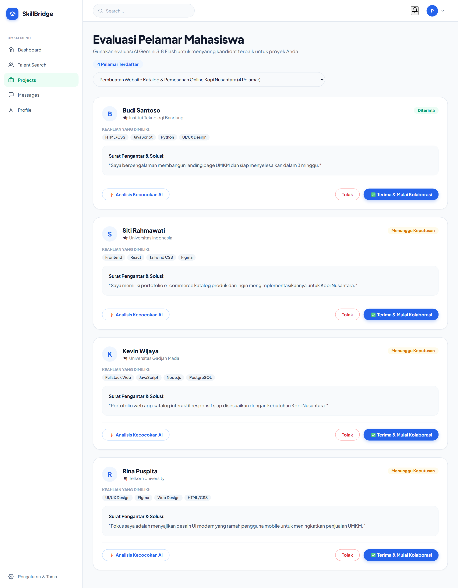

---

### 14. Pencarian Direktori Talenta Mahasiswa
- **Nama Berkas:** `14_umkm_talent_search.png`
- **Kategori:** Portal UMKM | **Peran Diuji:** `UMKM`
- **Dimensi Tangkapan:** 1440 × 1448 px (207 KB)
- **Tautan Halaman Sumber:** [`/pages/umkm/talent-search.html`](../frontend/pages/umkm/talent-search.html)
- **Deskripsi Antarmuka:** Eksplorasi profil mahasiswa bertalenta digital di berbagai universitas dengan filter keahlian, perguruan tinggi, dan tombol undang proyek.

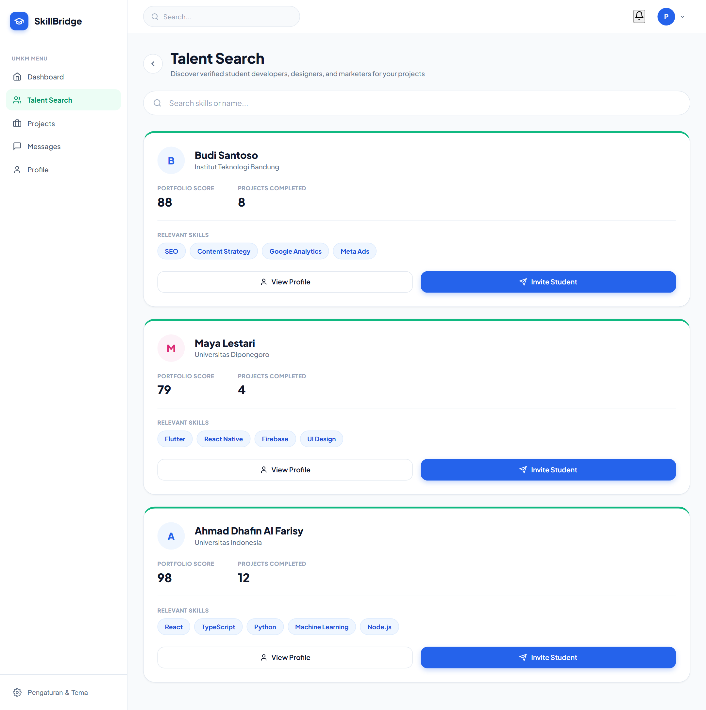

---

### 15. Profil Bisnis & Gerai UMKM
- **Nama Berkas:** `15_umkm_profile.png`
- **Kategori:** Portal UMKM | **Peran Diuji:** `UMKM`
- **Dimensi Tangkapan:** 1440 × 1150 px (301 KB)
- **Tautan Halaman Sumber:** [`/pages/umkm/profile.html`](../frontend/pages/umkm/profile.html)
- **Deskripsi Antarmuka:** Informasi identitas usaha mikro, kategori bisnis, deskripsi produk lokal, alamat fisik, dan verifikasi legalitas NIB.

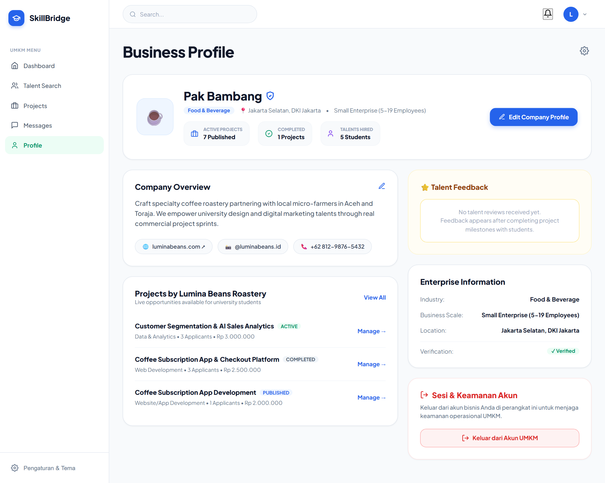

---

### 16. Pengaturan Akun & Keamanan UMKM
- **Nama Berkas:** `16_umkm_settings.png`
- **Kategori:** Portal UMKM | **Peran Diuji:** `UMKM`
- **Dimensi Tangkapan:** 1440 × 900 px (161 KB)
- **Tautan Halaman Sumber:** [`/pages/umkm/settings.html`](../frontend/pages/umkm/settings.html)
- **Deskripsi Antarmuka:** Pusat konfigurasi akun, preferensi notifikasi, nomor WhatsApp bisnis resmi, dan manajemen keamanan sesi.

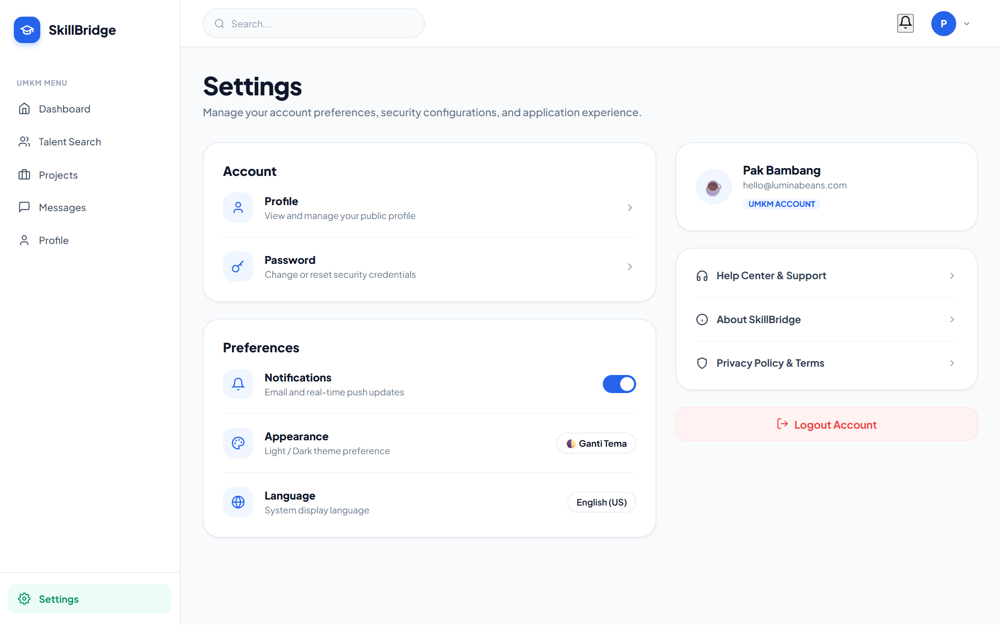

---

### 17. Dashboard Administrator & Metrik Sistem
- **Nama Berkas:** `17_admin_dashboard.png`
- **Kategori:** Portal Administrator | **Peran Diuji:** `ADMIN`
- **Dimensi Tangkapan:** 1440 × 900 px (108 KB)
- **Tautan Halaman Sumber:** [`/pages/admin/dashboard.html`](../frontend/pages/admin/dashboard.html)
- **Deskripsi Antarmuka:** Ringkasan statistik operasional ekosistem platform: total pengguna aktif, proyek terdanai, tingkat keberhasilan matchmaking, dan log audit sistem.

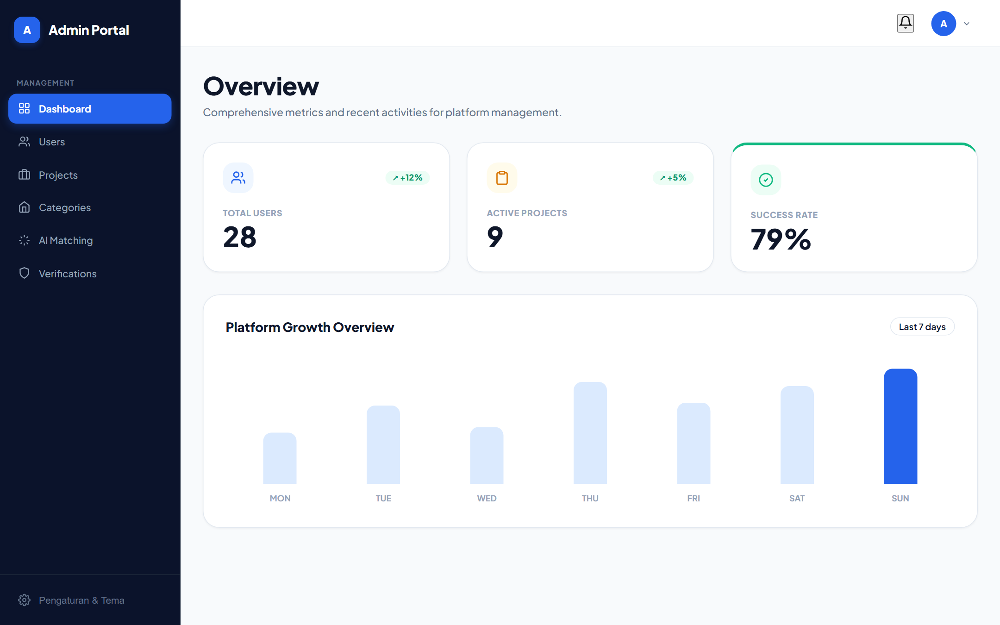

---

### 18. Manajemen Pengguna (Admin Users)
- **Nama Berkas:** `18_admin_users.png`
- **Kategori:** Portal Administrator | **Peran Diuji:** `ADMIN`
- **Dimensi Tangkapan:** 1440 × 1413 px (284 KB)
- **Tautan Halaman Sumber:** [`/pages/admin/users.html`](../frontend/pages/admin/users.html)
- **Deskripsi Antarmuka:** Tabel direktori seluruh akun pengguna (Mahasiswa, UMKM, Admin) dengan aksi verifikasi, pencarian, dan kontrol status suspensi.

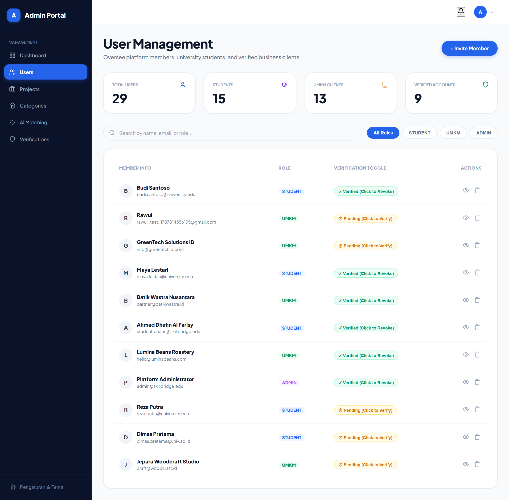

---

### 19. Manajemen Proyek Listing (Admin Projects)
- **Nama Berkas:** `19_admin_projects.png`
- **Kategori:** Portal Administrator | **Peran Diuji:** `ADMIN`
- **Dimensi Tangkapan:** 1440 × 900 px (206 KB)
- **Tautan Halaman Sumber:** [`/pages/admin/projects.html`](../frontend/pages/admin/projects.html)
- **Deskripsi Antarmuka:** Pengawasan seluruh listing proyek transformasi digital lintas kategori dengan filter status persetujuan dan monitoring stipend.

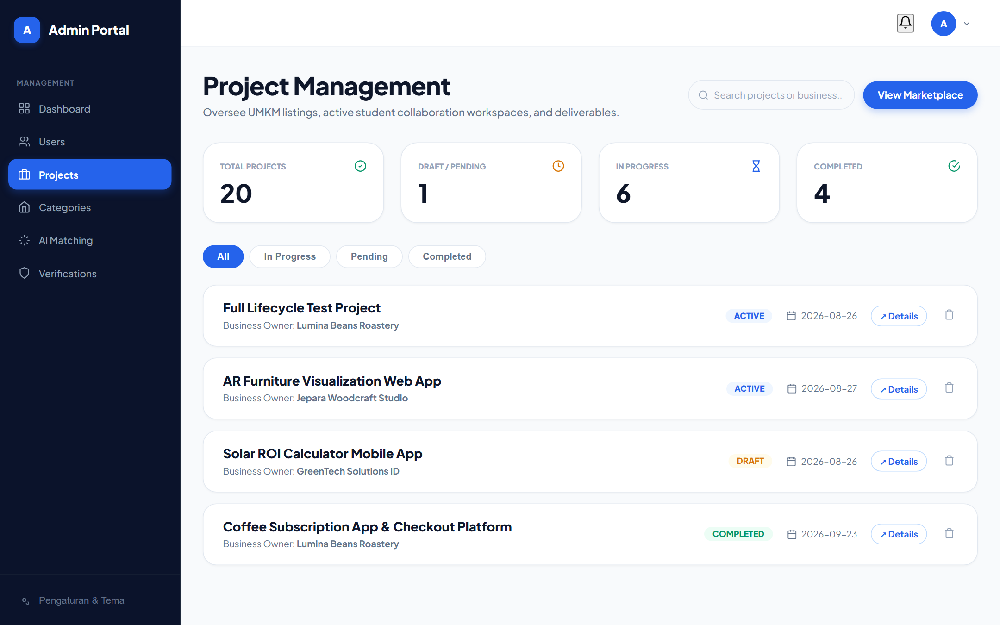

---

### 20. Verifikasi Dokumen Akademik & Legalitas NIB
- **Nama Berkas:** `20_admin_verification.png`
- **Kategori:** Portal Administrator | **Peran Diuji:** `ADMIN`
- **Dimensi Tangkapan:** 1440 × 1036 px (196 KB)
- **Tautan Halaman Sumber:** [`/pages/admin/verification.html`](../frontend/pages/admin/verification.html)
- **Deskripsi Antarmuka:** Pusat validasi berkas identitas mahasiswa (KTM/.ac.id) dan verifikasi legalitas izin usaha mikro (NIB/SKU).

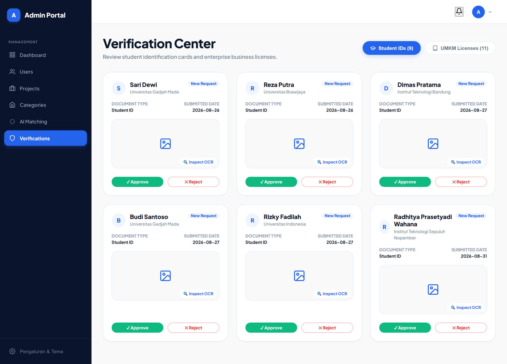

---

### 21. Manajemen Kategori Transformasi Digital
- **Nama Berkas:** `21_admin_categories.png`
- **Kategori:** Portal Administrator | **Peran Diuji:** `ADMIN`
- **Dimensi Tangkapan:** 1440 × 1083 px (172 KB)
- **Tautan Halaman Sumber:** [`/pages/admin/categories.html`](../frontend/pages/admin/categories.html)
- **Deskripsi Antarmuka:** Pengaturan master data kategori bidang digital (Web Dev, UI/UX, Social Media, Branding, Digital POS) beserta ikon dan deskripsinya.

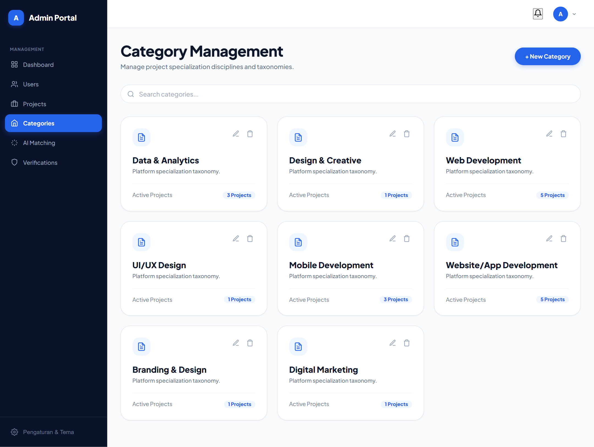

---

### 22. Monitoring Log & Kompatibilitas AI Matchmaking
- **Nama Berkas:** `22_admin_matching.png`
- **Kategori:** Portal Administrator | **Peran Diuji:** `ADMIN`
- **Dimensi Tangkapan:** 1440 × 2892 px (627 KB)
- **Tautan Halaman Sumber:** [`/pages/admin/matching.html`](../frontend/pages/admin/matching.html)
- **Deskripsi Antarmuka:** Dashboard analitik performa model Google Gemini Flash, distribusi skor keselarasan, waktu respons API, dan riwayat penalaran matchmaking.

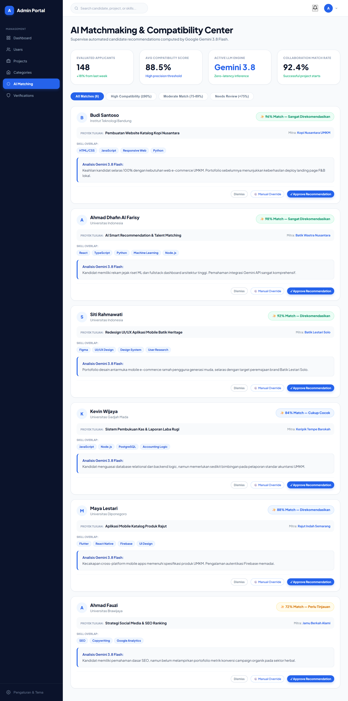

---

