# BAB II METODE DAN ARSITEKTUR TEKNOLOGI

> **Mata Kuliah:** Inovasi Sistem Informasi dan Teknologi (I1)  
> **Dosen Pengajar:** Badrus Zaman, S.Kom., M.Cs.  
> **Penyusun (Kelompok 10):**
> 1. Sakha’ Imtinan (187241017)
> 2. Ahmad Dhafin Al Farisy (187241057)
> 3. Isa Jahwa Fatimiyah (187241029)  
>
> **Program Studi S1 Sistem Informasi — Fakultas Sains dan Teknologi**  
> **Universitas Airlangga (2026)**  
> **Dokumen Referensi Proyek:** [Google Docs Kelompok 10](https://docs.google.com/document/d/1GqBGMRpm0Qar80G14j8B7VIVQ15P3VRfaTwmH1F0sdI/edit?tab=t.o4hqfojcd9fs)

---

## DAFTAR ISI BAB II

- [2.1 Gambaran Umum](#21-gambaran-umum)
  - [2.1.1 Pendekatan Berbasis Large Language Model (LLM)](#211-pendekatan-berbasis-large-language-model-llm)
  - [2.1.2 Komparasi Pendekatan Konvensional vs. LLM SkillBridge](#212-komparasi-pendekatan-konvensional-vs-llm-skillbridge)
  - [2.1.3 Paradigma Explainable AI (XAI) dalam Pencocokan Talenta](#213-paradigma-explainable-ai-xai-dalam-pencocokan-talenta)
- [2.2 Pengguna dan Hak Akses](#22-pengguna-dan-hak-akses)
  - [2.2.1 Definisi Aktor dan Fungsi Utama](#221-definisi-aktor-dan-fungsi-utama)
  - [2.2.2 Matriks Hak Akses Fungsional (RBAC Matrix)](#222-matriks-hak-akses-fungsional-rbac-matrix)
  - [2.2.3 Diagram Use Case Sistem](#223-diagram-use-case-sistem)
- [2.3 Alur Kerja Sistem (Activity Diagram)](#23-alur-kerja-sistem-activity-diagram)
  - [2.3.1 Alur Kerja Mahasiswa (Activity Diagram & Narasi)](#231-alur-kerja-mahasiswa)
  - [2.3.2 Alur Kerja Pelaku UMKM (Activity Diagram & Narasi)](#232-alur-kerja-pelaku-umkm)
  - [2.3.3 Mekanisme dan Tata Kelola Mesin AI Matchmaking](#233-mekanisme-dan-tata-kelola-mesin-ai-matchmaking)
- [2.4 Arsitektur Sistem](#24-arsitektur-sistem)
  - [2.4.1 Pola Decoupled Client-BaaS-AI Architecture](#241-pola-decoupled-client-baas-ai-architecture)
  - [2.4.2 Diagram Arsitektur 6 Lapisan](#242-diagram-arsitektur-6-lapisan)
  - [2.4.3 Pembahasan Rinci Enam Lapisan Sistem](#243-pembahasan-rinci-enam-lapisan-sistem)
  - [2.4.4 Evaluasi Arsitektur Awal vs. Arsitektur Rework](#244-evaluasi-arsitektur-awal-vs-arsitektur-rework)
- [2.5 Database](#25-database)
  - [2.5.1 Fondasi Relasional PostgreSQL 15+ & Integritas Data](#251-fondasi-relasional-postgresql-15-integritas-data)
  - [2.5.2 Diagram Relasi Entitas (Entity-Relationship Diagram)](#252-diagram-relasi-entitas-entity-relationship-diagram)
  - [2.5.3 Inventaris dan Spesifikasi 12 Entitas Basis Data](#253-inventaris-dan-spesifikasi-12-entitas-basis-data)
  - [2.5.4 Siklus Hidup dan State Machine Entitas Inti](#254-siklus-hidup-dan-state-machine-entitas-inti)
- [2.6 Keamanan dan Perlindungan Data](#26-keamanan-dan-perlindungan-data)
  - [2.6.1 Kepatuhan terhadap UU No. 27 Tahun 2022 (UU PDP)](#261-kepatuhan-terhadap-uu-no-27-tahun-2022-uu-pdp)
  - [2.6.2 Empat Pilar Strategi Keamanan Informasi SkillBridge](#262-empat-pilar-strategi-keamanan-informasi-skillbridge)
  - [2.6.3 Kebijakan Row-Level Security (RLS) di Tingkat Basis Data](#263-kebijakan-row-level-security-rls-di-tingkat-basis-data)
- [DAFTAR PUSTAKA](#daftar-pustaka)

---

## 2.1 Gambaran Umum

Platform **SkillBridge** dirancang sebagai sistem informasi cerdas yang menjembatani kesenjangan digital (*digital gap*) antara kompetensi digital mahasiswa perguruan tinggi dan kendala operasional Usaha Mikro, Kecil, dan Menengah (UMKM). Kesenjangan mendasar di lapangan terletak pada asimetri komunikasi: pelaku usaha mikro umumnya mengutarakan permasalahan bisnis dalam bahasa sehari-hari tanpa kosakata teknis (misalnya: *"toko sepi pembeli"*, *"catatan stok sering selisih"*, atau *"produk kurang dikenal orang"*), sementara mahasiswa mendeskripsikan keahlian dalam istilah industri spesifik (seperti *Search Engine Optimization / SEO*, *Social Media Marketing*, *UI/UX Design*, atau *Point of Sale System*).

### 2.1.1 Pendekatan Berbasis Large Language Model (LLM)

Untuk mengatasi hambatan semantik tersebut, SkillBridge mengintegrasikan model kecerdasan buatan berbasis **Large Language Model (LLM)**—secara spesifik memanfaatkan **Google Gemini 2.5 / 3.8 Flash**—sebagai mesin pemahaman bahasa alami (*Natural Language Processing*) dan mesin rekomendasi (*Recommendation Engine*). Model bahasa berskala besar ini telah dilatih menggunakan korpus teks multibahasa dalam volume masif sehingga memiliki kemampuan penalaran kontekstual (*contextual reasoning*), inferensi implisit, dan penerjemahan semantik lintas domain.

Pemrosesan kebutuhan UMKM dan kompetensi mahasiswa diserahkan kepada LLM melalui rancangan instruksi terstruktur (*prompt engineering*), bukan melalui algoritma pencocokan kata leksikal konvensional yang kaku. Pendekatan ini dipilih atas dasar tiga pertimbangan utama:
1. **Fleksibilitas Bahasa Natural:** Mampu menangkap maksud keluhan bahasa sehari-hari pelaku usaha mikro tanpa menuntut pengguna memahami taksonomi teknologi informasi.
2. **Keringanan Infrastruktur:** Menghilangkan keharusan membangun, melatih, dan menyetel (*fine-tuning*) model *machine learning* internal yang memerlukan infrastruktur GPU komputasi mahal dan himpunan data latihan (*training dataset*) awal yang sangat besar.
3. **Kemampuan Berargumentasi (*Explainability*):** LLM tidak hanya mengeluarkan skor numerik, melainkan mampu merumuskan narasi penjelasan rasional mengapa seorang mahasiswa cocok untuk suatu proyek, serta memberikan rekomendasi langkah praktis berikutnya bagi pemilik UMKM.

### 2.1.2 Komparasi Pendekatan Konvensional vs. LLM SkillBridge

Pendekatan konvensional dalam sistem perekomendasi lowongan pekerjaan umumnya mengandalkan metode *Term Frequency-Inverse Document Frequency* (TF-IDF) yang dipadukan dengan *Cosine Similarity* untuk menghitung sudut kedekatan vektor dokumen (Winardi et al., 2025). Meskipun penelitian Winardi et al. menunjukkan bahwa TF-IDF dapat menghasilkan nilai *Mean Average Precision* (MAP) sebesar 0,798 pada domain korpus lowongan kerja formal, metode tersebut memiliki kelemahan fatal ketika dihadapkan pada keluhan bahasa informal UMKM. Jika tidak terdapat irisan kata harfiah antara kalimat keluhan dan profil pelamar, skor kemiripan kosinus akan bernilai nol atau sangat rendah.

Perbandingan komparatif antara metode rujukan konvensional dengan arsitektur LLM pada SkillBridge dirangkum pada **Tabel 2.1**.

#### Tabel 2.1 Perbandingan Pendekatan dengan Referensi

| Dimensi Perbandingan | Pendekatan Konvensional (TF-IDF + Cosine Similarity) | Pendekatan SkillBridge (Large Language Model / LLM) | Implikasi & Keunggulan pada SkillBridge |
| :--- | :--- | :--- | :--- |
| **Dasar Penilaian** | Menghitung frekuensi kemunculan kata harfiah dan kemiripan vektor antar dokumen teks. | Memahami makna semantik mendalam, relasi implisit, dan konteks holistik teks. | Sistem mengenali bahwa masalah *"sepi pembeli"* berkaitan langsung dengan kebutuhan *Digital Marketing* atau *Social Media Management*. |
| **Pemahaman Bahasa Sehari-hari** | Rendah. Memerlukan kesamaan kata persis (*exact keyword matching*). | Sangat tinggi. Mampu menafsirkan kalimat percakapan informal dan bahasa lokal UMKM. | Pelaku UMKM tidak perlu mempelajari istilah baku industri; cukup mengetikkan keluhan secara apa adanya. |
| **Bentuk Penjelasan Hasil** | Berupa angka skalar tunggal (derajat kemiripan kosinus antara 0,00 hingga 1,00). | Persentase kecocokan terstandarisasi yang dilengkapi 2–3 kalimat rasionalisasi dan 3 butir saran aksi. | Menerapkan prinsip *Explainable AI* (XAI) sehingga pemilik UMKM memahami secara logis dasar rekomendasi yang diberikan. |
| **Kebutuhan Persiapan Data** | Memerlukan korpus dokumen khusus, tokenisasi, *stopword removal*, *stemming*, dan matriks leksikal. | Memerlukan struktur *prompt* instruksi yang presisi dan data profil teranonimasi dalam format JSON. | Waktu *deployment* jauh lebih singkat tanpa dependensi *pipeline* pra-pemrosesan teks yang kompleks. |
| **Kompleksitas Pembangunan** | Harus merancang arsitektur vektorisasi mandiri, komputasi matriks *sparse*, dan model pemeringkatan. | Mengintegrasikan *official SDK* model LLM via API RESTful terisolasi pada microservice backend. | Arsitektur sistem menjadi ramping (*lean*), modular, dan mudah dipelihara (*maintainable*). |
| **Peran Keputusan Pengguna** | Pemeringkatan otomatis tanpa kendali interaktif dari pemilik proyek. | Rekomendasi pendukung keputusan; keputusan akhir penerimaan tetap berada di tangan pemilik UMKM. | Menjaga prinsip etika *Human-in-the-loop*, di mana AI bertindak sebagai asisten cerdas, bukan penentu mutlak nasib pelamar. |

### 2.1.3 Paradigma Explainable AI (XAI) dalam Pencocokan Talenta

Sistem pendukung keputusan yang berbasis *black-box* sering kali menimbulkan ketidakpercayaan pengguna karena kegagalan menjelaskan latar belakang suatu skor. Pada SkillBridge, keluaran mesin pencocokan tidak pernah disajikan dalam bentuk persentase semata. Setiap hasil evaluasi selalu memuat komponen:
- **Kesesuaian Kompetensi:** Penjelasan keterampilan teknis mahasiswa yang secara langsung menjawab indikator capaian (*deliverables*) proyek.
- **Identifikasi Kesenjangan (*Skill Gap*):** Keterampilan pendukung yang belum dimiliki mahasiswa namun dapat dimitigasi selama pengerjaan.
- **Saran Tindak Lanjut Operasional:** Tiga rekomendasi taktis bagi pemilik UMKM untuk memandu mahasiswa sejak hari pertama kerja sama dimulai.

Dengan paradigma ini, transparansi algoritma terjaga penuh dan kolaborasi industri-kampus dapat dimulai dengan ekspektasi kerja yang selaras.

---

## 2.2 Pengguna dan Hak Akses

Platform SkillBridge melibatkan tiga entitas pengguna utama yang berinteraksi di dalam ekosistem: **Mahasiswa**, **Pemilik UMKM**, dan **Administrator Platform**. Setiap aktor memiliki peran fungsional yang terdefinisi secara ketat guna menjaga integritas data dan kelancaran alur kerja kolaboratif.

### 2.2.1 Definisi Aktor dan Fungsi Utama

1. **Mahasiswa (Talenta Digital Perguruan Tinggi):**
   - Merupakan mahasiswa aktif yang mendaftarkan diri menggunakan identitas akademik valid.
   - Bertanggung jawab melengkapi profil keahlian, riwayat pendidikan, tautan portofolio, serta sertifikat kompetensi.
   - Menjelajahi katalog proyek industri di *marketplace*, menggunakan filter kategori, dan mengajukan lamaran kerja dengan *pitch* singkat (*1-Click Apply*).
   - Menjalankan pekerjaan di ruang kerja kolaboratif (*workspace*), memperbarui *checklist milestone*, berkoordinasi melalui fitur pesan instan, dan menyerahkan berkas hasil kerja (*deliverables*).
   - Memberikan evaluasi bintang dan ulasan profesional kepada pihak UMKM setelah proyek tuntas.

2. **Pemilik UMKM (Mitra Industri / Usaha Mikro):**
   - Merupakan pelaku usaha mikro yang membutuhkan pendampingan digitalisasi usaha.
   - Menuliskan keluhan atau kebutuhan bisnis dalam bahasa sehari-hari yang selanjutnya dibantu oleh asisten AI untuk diformulasikan menjadi *brief* proyek terstruktur.
   - Mempublikasikan proyek ke *marketplace*, meninjau profil pelamar yang disajikan secara anonim (*data masking*), serta memanfaatkan analisis *AI Matchmaking* untuk mengambil keputusan seleksi.
   - Mengelola ruang kerja bersama, memantau *progress bar*, memberikan arahan teknis melalui *chat*, meminta revisi hasil kerja jika diperlukan, dan menyetujui penyerahan akhir proyek.
   - Memberikan *rating*, ulasan kepuasan, dan testimoni resmi yang secara otomatis memvalidasi portofolio mahasiswa di sistem.

3. **Administrator Platform:**
   - Bertanggung jawab menjaga keamanan operasional, ketertiban, dan keandalan ekosistem platform secara menyeluruh.
   - Memverifikasi legalitas pelaku usaha mikro (pemeriksaan nomor kontak, lokasi, dan profil usaha) serta memvalidasi kredensial akademik mahasiswa.
   - Melakukan moderasi terhadap *brief* proyek yang diterbitkan guna memastikan tidak ada proyek yang melanggar hukum, mengandung konten terlarang, atau eksploitasi kerja tanpa stipend yang layak.
   - Memantau statistik lalu lintas sistem, metrik keberhasilan kolaborasi, serta memeriksa log audit (*audit trail*) untuk mendeteksi anomali aktivitas keamanan.

### 2.2.2 Matriks Hak Akses Fungsional (RBAC Matrix)

Pemisahan hak akses diimplementasikan menggunakan model **Role-Based Access Control (RBAC)**. Pembatasan ini ditegakkan di dua lapisan sekaligus: antarmuka pengguna (*client-side route guard*) dan gerbang kueri basis data (*database Row-Level Security*). Rincian hak akses disajikan pada **Tabel 2.2**.

#### Tabel 2.2 Peran Pengguna dan Matriks Hak Akses pada SkillBridge

| Entitas Peran | Fungsi Utama Pengguna | Modul Fungsional yang Diakses | Izin Operasi Baca (*Read*) | Izin Operasi Tulis (*Create/Update*) | Batasan & Aturan Keamanan Sistem |
| :--- | :--- | :--- | :--- | :--- | :--- |
| **Mahasiswa** | Mengembangkan portofolio nyata, melamar proyek industri, eksekusi tugas, koordinasi, dan saling menilai. | • Marketplace Proyek • Profil Mahasiswa • Riwayat Lamaran • Workspace Kolaborasi • Modul Review | • Katalog proyek berstatus `PUBLISHED` • Profil diri sendiri • Status lamaran sendiri • Ruang kerja proyek yang diikuti • Pesan & tugas internal workspace | • Mengedit data profil akademik sendiri • Mengajukan lamaran baru (1 lamaran per proyek) • Menandai centang tugas yang ditugaskan • Mengirim pesan obrolan di workspace aktif • Mengunggah tautan deliverable akhir • Membuat review untuk UMKM mitra | • Dilarang membuat, mengedit, atau menghapus listing proyek. • Tidak dapat melihat data kontak langsung UMKM sebelum lamaran diterima (*Double Opt-In*). • Tidak memiliki akses ke portal administrasi sistem. |
| **Pemilik UMKM** | Merumuskan kebutuhan digital, publikasi proyek, seleksi kandidat berbantuan AI, supervisi, dan ulasan. | • Form Pembuatan Brief • Dashboard Proyek Saya • Evaluasi Pelamar AI • Workspace Kolaborasi • Modul Review | • Profil diri dan entitas usaha sendiri • Daftar pelamar pada proyek miliknya (profil anonim) • Skor kecocokan & rasionalisasi AI • Ruang kerja proyek miliknya • Ulasan yang diterima | • Membuat draft & menerbitkan proyek baru • Mengedit rincian proyek miliknya • Mengubah status lamaran (`ACCEPTED`/`REJECTED`) • Menambah/mengedit checklist tugas workspace • Mengirim pesan obrolan di workspace aktif • Menyetujui deliverable & menyelesaikan proyek • Membuat ulasan untuk mahasiswa | • Dilarang melamar ke proyek lain. • Dilarang mengakses identitas sensitif mahasiswa (nama lengkap, kontak, NIM) pada fase pelamaran awal. • Dilarang memodifikasi proyek milik pelaku usaha lain. |
| **Administrator** | Verifikasi pengguna, moderasi konten, pemantauan kesehatan platform, dan penegakan tata tertib. | • Admin Control Center • Verifikasi Akun & Usaha • Moderasi Katalog Proyek • Audit Log & Keamanan | • Seluruh profil pengguna (`users`, `student`, `umkm`) • Seluruh proyek di semua status • Seluruh log audit sistem • Statistik agregat platform | • Memperbarui status verifikasi akun (`is_verified`) • Mengubah status moderasi proyek (`ARCHIVED`/`PUBLISHED`) • Menghapus konten yang melanggar pedoman komunitas | • Dilarang menyamar (*impersonate*) untuk mengirim pesan privat di dalam workspace aktif. • Setiap aksi modifikasi data otomatis tercatat permanen di tabel `audit_logs`. |

### 2.2.3 Diagram Use Case Sistem

Hubungan interaksi antara ketiga aktor dengan batasan sistem SkillBridge dimodelkan melalui **Use Case Diagram** berikut.

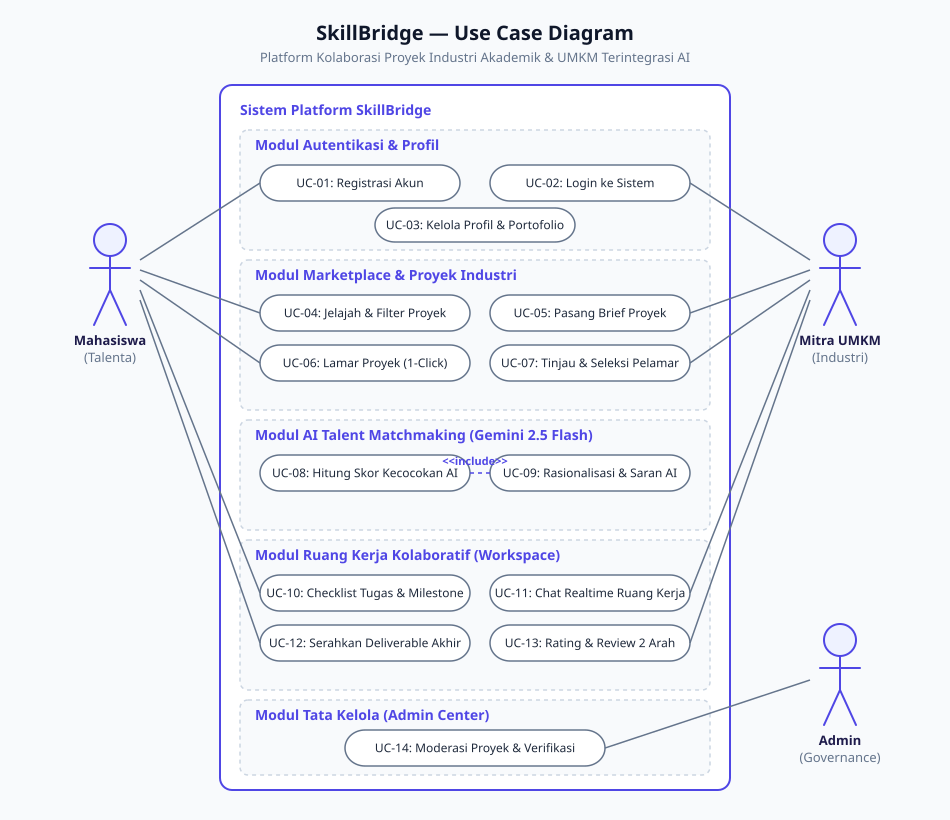

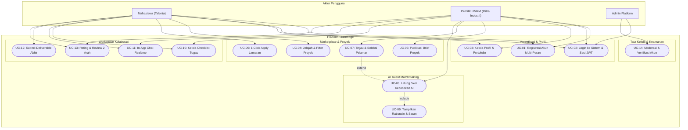

---

## 2.3 Alur Kerja Sistem (Activity Diagram)

Alur kerja operasional platform SkillBridge dirancang terstruktur dan berpusat pada interaksi yang transparan antara mahasiswa dan mitra UMKM. Bagian ini menguraikan diagram aktivitas sistem dari sudut pandang mahasiswa, sudut pandang UMKM, serta mekanisme kerja mendalam mesin AI Matchmaking.

### 2.3.1 Alur Kerja Mahasiswa

Alur kerja mahasiswa mencakup rangkaian proses sejak registrasi awal, pengisian profil akademik, pencarian proyek, pelamaran, kolaborasi berbasis tugas, hingga penyerahan deliverable dan perolehan ulasan terverifikasi. Alur ini divisualisasikan pada **Gambar 2.1**.

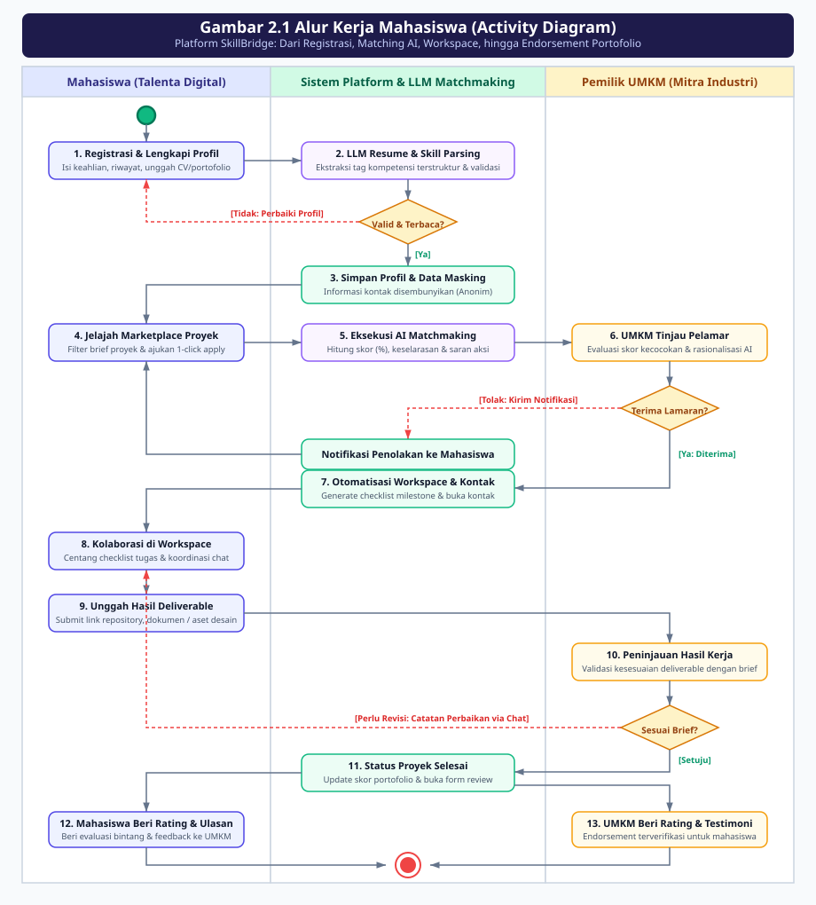

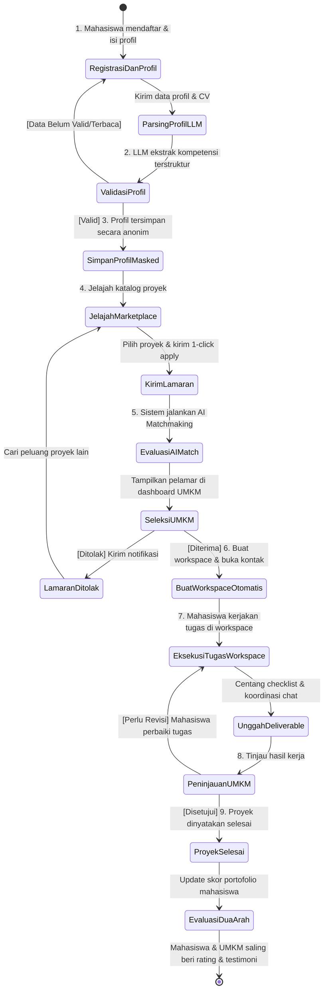

#### Narasi Tahapan Operasional Alur Mahasiswa:
1. **Registrasi dan Pengisian Profil Akademik:** Mahasiswa mendaftar akun baru menggunakan email institusi, kemudian melengkapi profil keahlian (*skill tags*), riwayat kampus, portofolio digital, dan mengunggah berkas CV/sertifikat.
2. **Ekstraksi Kompetensi Otomatis oleh LLM:** Sistem memeriksa integritas masukan, lalu memanfaatkan model LLM untuk membedah teks profil dan berkas CV (*resume parsing*) guna mengekstraksi taksonomi kompetensi terstandarisasi.
3. **Penyimpanan Profil Teranonimasi (*Data Masking*):** Jika validasi berhasil, profil disimpan di basis data. Data identitas kontak privat (NIM, nomor HP, email pribadi) otomatis disembunyikan (*masked*) agar hanya kompetensi objektif yang dapat dilihat oleh calon mitra industri.
4. **Eksplorasi Marketplace & Pengajuan Lamaran:** Mahasiswa menjelajahi etalase proyek terbuka, memilih proyek yang sesuai minat bakat, menuliskan pernyataan ketertarikan (*pitch*), dan menekan tombol *Lamar Proyek Ini*.
5. **Kalkulasi Keselarasan AI (*AI Matchmaking*):** Sistem memproses data pelamar dengan *brief* proyek melalui microservice AI untuk menghasilkan skor keselarasan, ulasan kesesuaian, dan saran tindak lanjut.
6. **Keputusan Seleksi oleh Mitra UMKM:** UMKM meninjau pelamar. Jika ditolak, notifikasi dikirimkan ke mahasiswa dan alur lamaran selesai. Jika diterima, sistem secara otomatis menerbitkan ruang kerja terisolasi (*workspace*) serta membuka kontak komunikasi resmi kedua belah pihak (*Double Opt-In*).
7. **Pengerjaan Tugas di Ruang Kolaborasi:** Mahasiswa masuk ke *workspace*, menjalankan tahapan kerja terarah sesuai *milestone*, menandai tugas yang tuntas (yang seketika memperbarui *progress bar*), dan berdiskusi dengan mitra via obrolan instan.
8. **Pengajuan Hasil Kerja (*Deliverables*):** Mahasiswa mengunggah tautan berkas akhir pekerjaan (misalnya tautan repositori kode, prototipe Figma, materi kampanye media sosial, atau dokumen panduan teknis) untuk dievaluasi oleh UMKM.
9. **Persetujuan & Pembaruan Portofolio Terverifikasi:** Apabila UMKM menyetujui hasil deliverable, proyek ditutup dengan status `COMPLETED`. Sistem secara otomatis memperbarui *counter* proyek selesai dan skor portofolio mahasiswa.
10. **Pemberian Ulasan Dua Arah:** Mahasiswa memberikan ulasan kepuasan terhadap pengalaman kemitraan bersama UMKM, dan UMKM menyematkan testimoni resmi yang menjadi bukti rekam jejak industri mahasiswa.

---

### 2.3.2 Alur Kerja Pelaku UMKM

Alur kerja UMKM mendampingi pelaku usaha sejak memasukkan kebutuhan bisnis dalam bahasa sehari-hari, konversi brief oleh AI, seleksi pelamar berbantuan AI, supervisi workspace, hingga penyelesaian proyek. Alur ini divisualisasikan pada **Gambar 2.2**.

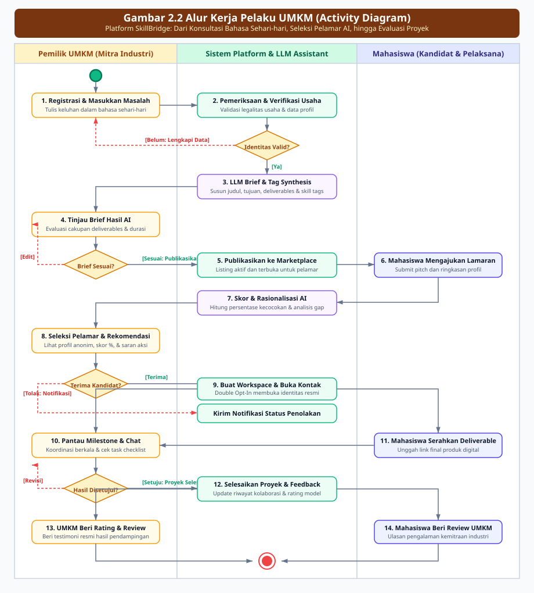

```mermaid
stateDiagram-v2
  [*] --> FormKeluhanBisnis: 1. UMKM mendaftar & tulis keluhan sehari-hari
  FormKeluhanBisnis --> VerifikasiUsaha: 2. Sistem verifikasi identitas & data usaha
  
  state VerifikasiUsaha <<choice>>
  VerifikasiUsaha --> FormKeluhanBisnis: [Data Belum Lengkap] Perbaiki data
  VerifikasiUsaha --> LLMBriefSynthesis: [Valid] 3. LLM rancang brief & tag kebutuhan

  LLMBriefSynthesis --> ReviewBriefAI: 4. UMKM tinjau draft brief proyek hasil AI
  
  state ReviewBriefAI <<choice>>
  ReviewBriefAI --> LLMBriefSynthesis: [Belum Sesuai] Sesuaikan instruksi / edit
  ReviewBriefAI --> PublishMarketplace: [Sesuai] 5. Publikasikan proyek ke marketplace

  PublishMarketplace --> TerimaLamaran: Proyek listing aktif; mahasiswa melamar
  TerimaLamaran --> KalkulasiAIMatch: 6. Sistem hitung skor kecocokan AI (%)
  KalkulasiAIMatch --> TinjauPelamar: 7. UMKM evaluasi profil pelamar & skor AI

  state TinjauPelamar <<choice>>
  TinjauPelamar --> NotifikasiTolak: [Tolak] Kirim notifikasi status
  NotifikasiTolak --> TerimaLamaran: Tunggu atau seleksi pelamar lain
  TinjauPelamar --> BuatWorkspaceBaru: [Terima] 8. Sistem otomatis buat workspace kolaborasi

  BuatWorkspaceBaru --> MonitoringMilestone: 9. Supervisi milestone & chat koordinasi
  MonitoringMilestone --> EvaluasiDeliverable: Mahasiswa unggah tautan hasil kerja

  state EvaluasiDeliverable <<choice>>
  EvaluasiDeliverable --> MonitoringMilestone: [Revisi] Kirim catatan perbaikan via chat
  EvaluasiDeliverable --> SelesaiProyek: [Disetujui] 10. Proyek selesai & beri rating/ulasan

  SelesaiProyek --> [*]: Testimoni tersimpan, memperkaya riwayat kolaborasi
```

#### Narasi Tahapan Operasional Alur UMKM:
1. **Registrasi Akun & Penginputan Kendala Usaha:** Pelaku UMKM mendaftarkan akun usaha, mengisi profil bisnis, dan menceritakan permasalahan yang dihadapi menggunakan bahasa natural sehari-hari.
2. **Pemeriksaan & Verifikasi Kredibilitas Usaha:** Sistem memeriksa keabsahan nomor kontak, bidang usaha, dan alamat operasional guna menjamin keamanan mahasiswa yang akan berkolaborasi.
3. **Sintesis Brief Proyek Otomatis oleh LLM:** LLM menerjemahkan kalimat permasalahan menjadi format *brief* formal yang mencakup judul proyek, tujuan strategis, daftar capaian konkret (*deliverables*), estimasi waktu, rekomendasi stipend, dan tag keahlian teknologi.
4. **Peninjauan & Penyesuaian Brief:** Pelaku UMKM meninjau draft usulan AI. Pelaku usaha dapat menyunting target capaian sesuai preferensi personal sebelum proyek diluncurkan.
5. **Publikasi ke Marketplace:** Proyek diterbitkan dengan status `PUBLISHED` dan langsung dapat ditelusuri oleh mahasiswa di seluruh perguruan tinggi.
6. **Penerimaan Lamaran & Penilaian Cerdas:** Setiap berkas lamaran yang diajukan mahasiswa diproses secara asinkron oleh mesin *AI Matchmaking* untuk mengukur kesesuaian profil kandidat terhadap spesifikasi proyek.
7. **Seleksi Kandidat Berbasis Penjelasan AI:** Pemilik UMKM membuka dasbor pelamar, membaca skor persentase keselarasan beserta ulasan rasionalisasi dan saran tindak lanjut, lalu menetapkan keputusan penerimaan.
8. **Inisialisasi Workspace Otomatis:** Saat tombol *Terima* diklik, status proyek beralih menjadi `ACTIVE`, workspace bersama terinisialisasi lengkap dengan *checklist* tugas bawaan yang diambil dari rincian *deliverables*.
9. **Supervisi Pengerjaan & Komunikasi Real-time:** Mitra UMKM memantau perkembangan tugas secara berkala, memeriksa *progress bar*, dan memberikan masukan langsung melalui fitur percakapan instan.
10. **Evaluasi Akhir, Pengesahan, dan Pemberian Testimoni:** Pemilik usaha menguji deliverable yang dikirimkan. Jika memuaskan, proyek disahkan sebagai `COMPLETED`. UMKM mengisi formulir rating bintang dan testimoni kepuasan yang tercatat permanen di profil portofolio mahasiswa.

---

### 2.3.3 Mekanisme dan Tata Kelola Mesin AI Matchmaking

Mesin *AI Talent Matchmaking* pada SkillBridge bertindak sebagai sistem pendukung keputusan (*Decision Support System*). Arsitektur eksekusi evaluasi kandidat ditunjukkan pada diagram sekuens berikut.

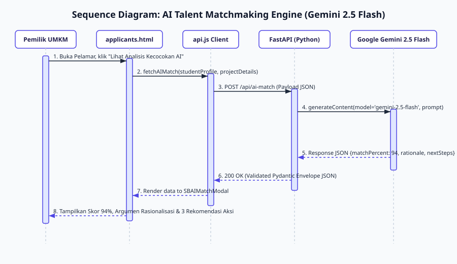

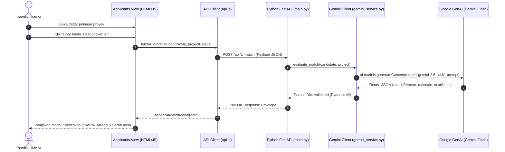

#### Tiga Komponen Input Prompt AI:
1. **Rincian Brief Proyek UMKM:** Judul proyek, deskripsi permasalahan bisnis, daftar *deliverables*, tingkat kesulitan, dan kumpulan tag keahlian yang disyaratkan.
2. **Ringkasan Profil Mahasiswa Teranonimasi:** Ringkasan keahlian (*skills*), sertifikat kompetensi, skor portofolio berjalan, dan deskripsi *pitch* lamaran (tanpa menyertakan nama, NIM, kontak, atau alamat fisik).
3. **Instruksi Terstruktur (*Strict JSON Schema*):** Instruksi operasional yang mewajibkan LLM mengembalikan format JSON murni dengan parameter:
   - `matchPercent`: Bilangan bulat terstandarisasi (antara 60 s.d. 99%).
   - `rationale`: 2–3 kalimat ringkas mengenai kesesuaian keterampilan kandidat dan aspek yang perlu dioptimalkan.
   - `recommendedNextSteps`: 3 butir saran konkret bagi UMKM untuk memandu kandidat selama kolaborasi.

#### Empat Prinsip Tata Kelola, Kualitas, dan Keamanan AI:
1. **Keputusan Akhir pada Manusia (*Human-in-the-Loop*):** AI hanya berfungsi menyajikan analisis komparatif dan pertimbangan logis. Hak mutlak untuk menerima atau menolak lamaran sepenuhnya dipegang oleh pemilik UMKM.
2. **Transparansi Rasionalisasi (*Explainability*):** Sistem menolak model rekomendasi angka buta (*opaque scoring*). Setiap penilaian wajib disertai argumentasi tertulis sehingga pemilik usaha memahami alasan di balik angka tersebut.
3. **Privasi Berbasis Desain (*Privacy-by-Design*):** Informasi identitas sensitif (PII) tidak pernah disalurkan ke penyedia layanan AI pihak ketiga. Model hanya mengevaluasi aspek keahlian teknis secara murni dan objektif.
4. **Format Terkontrol & Mekanisme Failover (*Fallback Engine*):** Respon keluaran AI divalidasi ketat menggunakan pustaka *Pydantic v2*. Jika terjadi kendala kuota API atau kegagalan koneksi jaringan, sistem secara otomatis mengaktifkan algoritma *fallback* berbasis *Jaccard Similarity* terhadap himpunan tag keahlian untuk menjamin ketersediaan layanan (*high availability*).

---

## 2.4 Arsitektur Sistem

Untuk menghadirkan platform yang andal, berkinerja tinggi, dan mudah dikembangkan, arsitektur SkillBridge disusun menggunakan pola **Decoupled Client-BaaS-AI Architecture**. Arsitektur ini memisahkan antarmuka pengguna, gerbang keamanan data, orkestrasi basis data, dan komputasi analitik kecerdasan buatan ke dalam lapisan independen.

### 2.4.1 Pola Decoupled Client-BaaS-AI Architecture

Arsitektur ini menghubungkan tiga pilar teknologi utama:
1. **Klien Web (Frontend Tier):** Berjalan secara *native* di peramban pengguna menggunakan standar web murni (HTML5 Semantic, CSS Modern berbasis variabel desain, dan JavaScript modular ES6+). Klien berkomunikasi langsung dengan gerbang Supabase untuk operasi data rutin dan berinteraksi dengan microservice AI untuk kebutuhan evaluasi analitik.
2. **Backend-as-a-Service (Supabase Platform Tier):** Menyediakan fondasi enterprise berupa basis data relasional PostgreSQL 15+, autentikasi berbasis JSON Web Token (GoTrue Engine), perutean *Row-Level Security* (RLS), *Realtime CDC WebSocket*, dan penyimpanan berkas terenkripsi (*Cloud Storage*).
3. **AI Microservice (Python FastAPI Tier):** Berperan sebagai modul komputasi independen berbasis Python 3.10+ asinkron yang menangani pemanggilan SDK Google Gemini 2.5 / 3.8 Flash, validasi muatan Pydantic, isolasi kunci API rahasia (*GEMINI_API_KEY*), dan algoritma *fallback*.

### 2.4.2 Diagram Arsitektur 6 Lapisan

Struktur berlapis sistem SkillBridge diilustrasikan secara komprehensif pada **Gambar 2.3**.

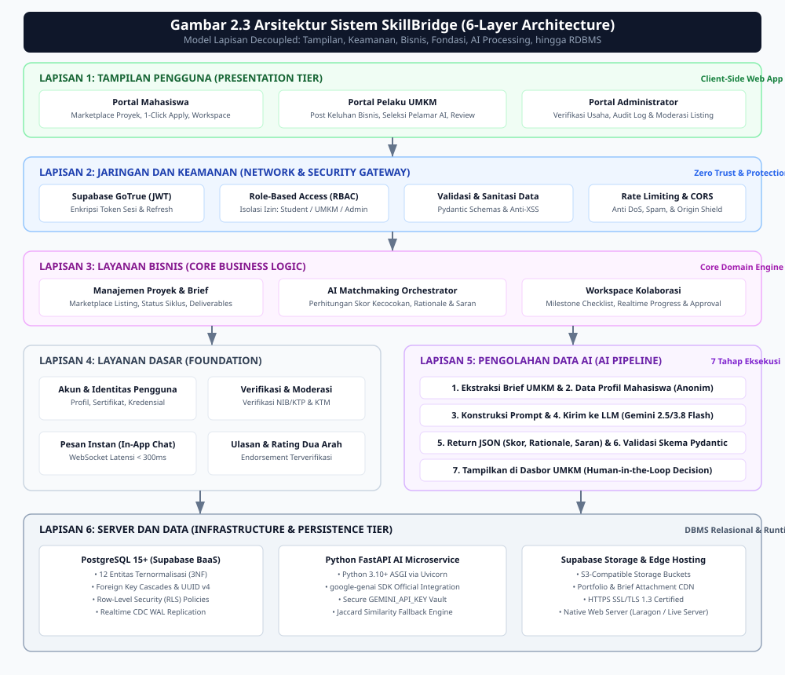

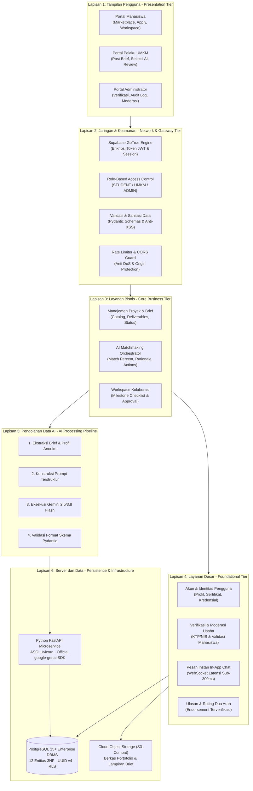

### 2.4.3 Pembahasan Rinci Enam Lapisan Sistem

1. **Lapisan 1: Tampilan Pengguna (Presentation Tier):**
   - Merupakan antarmuka web responsif yang diakses langsung melalui peramban modern di perangkat desktop maupun seluler.
   - Dibangun menggunakan standar Semantic HTML5, CSS Variables (*design tokens* yang konsisten), Vanilla JavaScript modular, dan pustaka ikonik Lucide.
   - Bebas dari ketergantungan *heavyweight bundler* (seperti Webpack atau bundler besar lainnya) sehingga proses pemuatan halaman instan dan kompatibel dengan lingkungan web server lokal (seperti Laragon/Nginx) maupun *production edge hosting*.
2. **Lapisan 2: Jaringan dan Keamanan (Network and Security Gateway):**
   - Menjadi garis pertahanan pertama bagi seluruh lalu lintas data yang masuk ke sistem.
   - **Autentikasi Token JWT:** Supabase GoTrue menerbitkan token kriptografis berbatas waktu (*expires-in*) yang memuat klaim peran pengguna (*role claims*).
   - **Pencegahan Penyalahgunaan:** Mengimplementasikan kebijakan CORS ketat yang membatasi akses API hanya dari domain resmi, sanitasi input untuk memitigasi risiko *Cross-Site Scripting* (XSS) dan injeksi data, serta *Rate Limiting* untuk mencegah serangan *brute-force* dan spam.
3. **Lapisan 3: Layanan Bisnis (Core Business Logic):**
   - Mengorkestrasi aturan bisnis utama (*core domain*), mencakup siklus hidup listing proyek, pendaftaran pelamar, inisialisasi ruang kerja otomatis saat pelamar diterima, kalkulasi pembaruan progres tugas (*progress bar* otomatis), dan validasi penyelesaian proyek.
4. **Lapisan 4: Layanan Dasar (Foundational Services):**
   - Menyediakan utilitas penunjang bersama yang dimanfaatkan oleh modul bisnis:
     - **Identity & Verification Service:** Mengelola profil pengguna dan status verifikasi akun.
     - **Realtime Messaging Service:** Menyalurkan pesan obrolan dan pembaruan centang tugas secara langsung menggunakan protokol WebSocket CDC (*Change Data Capture*) dengan latensi di bawah 300 milidetik.
     - **Reputation & Review Service:** Mengelola pencatatan rating bintang dua arah dan rekalkulasi reputasi skor portofolio mahasiswa.
5. **Lapisan 5: Pengolahan Data AI (AI Pipeline):**
   - Menjalankan alur pencocokan talenta dalam tahapan berurutan:
     1. Menarik data kebutuhan proyek dari tabel `projects`.
     2. Menarik riwayat keahlian dari tabel `student_profiles` dengan menyaring data pribadi (*data masking*).
     3. Menyusun *prompt context* instruksi sistem.
     4. Mengirim muatan ke model Google Gemini melalui koneksi HTTPS TLS 1.3 aman.
     5. Menerima respon terstruktur berupa persentase, ulasan keselarasan, dan langkah kerja.
     6. Memvalidasi tipe data respon menggunakan model Pydantic.
     7. Menampilkan hasil terverifikasi ke hadapan pengguna.
6. **Lapisan 6: Server dan Basis Data (Persistence and Infrastructure Tier):**
   - Bertindak sebagai fondasi penyimpanan permanen dan komputasi backend:
     - **PostgreSQL 15+:** Menjamin keandalan transaksi data tingkat ACID (*Atomicity, Consistency, Isolation, Durability*), integritas kunci asing terisolasi, dan penegakan *Row-Level Security*.
     - **Python FastAPI (ASGI):** Menjalankan layanan RESTful mikro berkemampuan asinkron tinggi untuk menaungi logika integrasi AI dan *fallback algorithm*.
     - **Supabase Cloud Storage:** Menyimpan berkas statis portofolio, dokumen lampiran brief, dan avatar profil dengan hak akses terkontrol.

### 2.4.4 Evaluasi Arsitektur Awal vs. Arsitektur Rework

Sebelum mencapai arsitektur yang digunakan saat ini, sistem sempat dirancang menggunakan tumpukan monolitik *React 19 + TypeScript + Vite + Node.js Express 5 + Prisma ORM + MySQL*. Berdasarkan tinjauan rekayasa perangkat lunak, tumpukan awal tersebut dievaluasi dan direstrukturisasi menjadi arsitektur Rework. Perbandingannya disajikan pada **Tabel 2.3**.

#### Tabel 2.3 Evaluasi Arsitektur Awal vs Arsitektur Rework

| Komponen Arsitektur | Implementasi Awal (Monolith) | Implementasi Rework (Decoupled BaaS-AI) | Keuntungan Akademik & Operasional |
| :--- | :--- | :--- | :--- |
| **Frontend Framework** | React 19 + TypeScript + Vite (Bundled) | Semantic HTML5 + Modern CSS + Vanilla JS | Bebas kompilasi bundler rumit, proses *cold start* seketika, dan ramah standar W3C. |
| **Backend & Routing** | Node.js Express 5 + TSX runtime | Python 3.10+ FastAPI (ASGI Framework) | Kompatibilitas natif dengan pustaka kecerdasan buatan, eksekusi asinkron tinggi, dan validasi Pydantic. |
| **Database & ORM** | MySQL + Prisma ORM 5.22 | PostgreSQL 15+ Enterprise via Supabase BaaS | Mempertahankan konsep basis data relasional murni dengan dukungan bawaan *Row-Level Security* (RLS). |
| **Realtime Messaging** | Polling HTTP berkala / Custom Socket | Supabase Realtime (CDC WebSocket Engine) | Pertukaran pesan instan dengan latensi < 300ms tanpa beban pemeliharaan daemon socket mandiri. |
| **Penyimpanan Berkas** | Disk Lokal Server via Multer (`uploads/`) | Supabase Cloud Storage (S3-Compatible) | Aset portofolio terisolasi aman di penyimpanan awan dengan akses tautan publik/privat bersertifikasi. |
| **Integrasi AI** | Node SDK di server Express | Python SDK Resmi (`google-genai`) | Struktur kode bersih, pemisahan beban kerja analitik intensif, dan keamanan kunci API terjamin. |

---

## 2.5 Database

Sistem SkillBridge mengelola data secara relasional dan terpusat pada sistem manajemen basis data **PostgreSQL 15+** yang dihosting melalui platform Supabase. Rancangan skema dirancang memenuhi kaidah **Bentuk Normal Ketiga (3NF)** guna meniadakan redundansi data, menghindari anomali modifikasi (*insert/update/delete anomaly*), dan memastikan integritas referensial antar entitas.

### 2.5.1 Fondasi Relasional PostgreSQL 15+ & Integritas Data

1. **Standardisasi Kunci Primer UUID v4:** Seluruh entitas tabel menggunakan *Universally Unique Identifier* (UUID versi 4 via fungsi `gen_random_uuid()`). Hal ini mencegah kerentanan enumerasi ID (*ID enumeration attack*) yang rentan terjadi pada pola bilangan bulat berurutan (*auto-increment integer*).
2. **Penegakan Integritas Referensial (*Foreign Key Constraints*):** Hubungan relasi antar entitas diproteksi oleh klausul integritas eksplisit, seperti `ON DELETE CASCADE` untuk data turunan yang bergantung mutlak pada data induk (misalnya *profile*, *task*, dan *application* terhadap *user* atau *project*), serta `ON DELETE RESTRICT` pada tabel referensi kategori.
3. **Validasi Batasan Data (*CHECK Constraints*):** Nilai masukan dibatasi secara tegas di tingkat basis data, seperti validasi peran pengguna (`CHECK (role IN ('STUDENT', 'UMKM', 'ADMIN'))`), skala skor portofolio (`CHECK (portfolio_score BETWEEN 0 AND 100)`), status proyek (`CHECK (status IN ('DRAFT', 'PUBLISHED', 'ACTIVE', 'COMPLETED', 'ARCHIVED'))`), dan skala rating (`CHECK (rating BETWEEN 1 AND 5)`).

### 2.5.2 Diagram Relasi Entitas (Entity-Relationship Diagram)

Struktur relasi dan keterhubungan antara ke-12 tabel dalam basis data SkillBridge digambarkan pada **Gambar 2.4**.

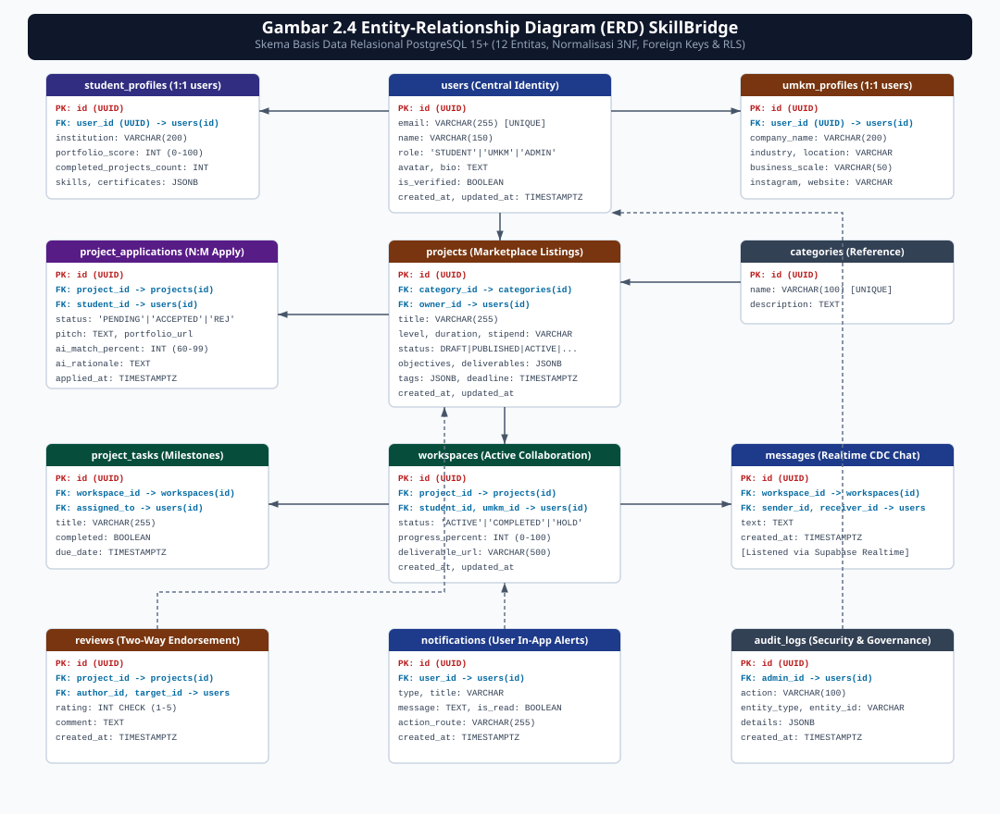

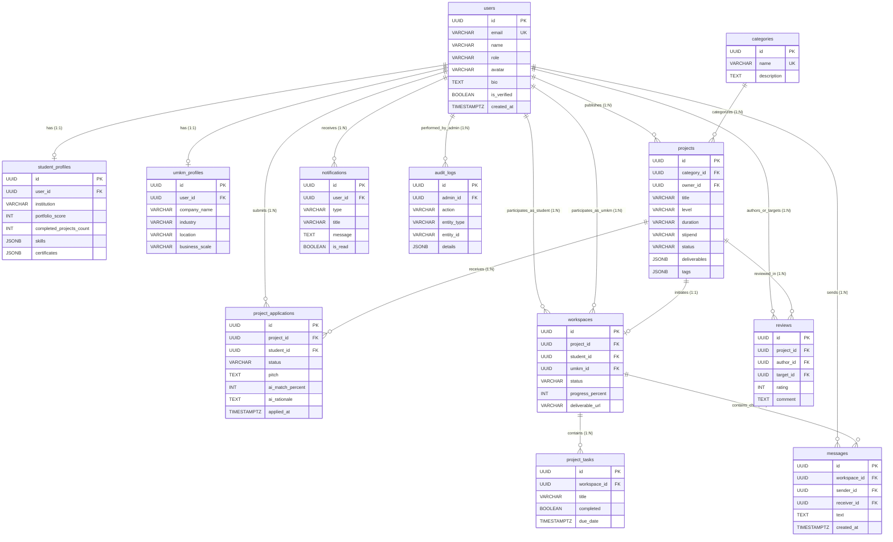

### 2.5.3 Inventaris dan Spesifikasi 12 Entitas Basis Data

Ringkasan seluruh entitas tabel basis data beserta domain peruntukannya disajikan pada **Tabel 2.4**.

#### Tabel 2.4 Inventaris Entitas Basis Data SkillBridge

| ID Tabel | Nama Tabel | Domain Fungsional Sistem | Keterangan Hubungan Relasi | Estimasi Volume Rekaman |
| :--- | :--- | :--- | :--- | :--- |
| **TBL-01** | `users` | Entitas identitas akun pusat & autentikasi sistem. | Terhubung 1:1 ke tabel `auth.users` Supabase. | 1.000 – 50.000 baris |
| **TBL-02** | `student_profiles` | Latar belakang akademik, keahlian, dan portofolio mahasiswa. | Relasi 1:1 terhadap `users(id)` via `user_id`. | 1.000 – 40.000 baris |
| **TBL-03** | `umkm_profiles` | Identitas usaha mikro, legalitas, skala bisnis, dan kontak. | Relasi 1:1 terhadap `users(id)` via `user_id`. | 500 – 10.000 baris |
| **TBL-04** | `categories` | Taksonomi kategori bidang proyek digital (Web, UI/UX, AI, dll.). | Relasi 1:N terhadap `projects(category_id)`. | 10 – 30 baris |
| **TBL-05** | `projects` | Data *brief* proyek industri, tujuan, target deliverable, status. | Relasi N:1 ke `users(id)` dan `categories(id)`. | 500 – 15.000 baris |
| **TBL-06** | `project_applications` | Pendaftaran lamaran mahasiswa, pitch, dan nilai analisis AI. | Relasi N:M menghubungkan mahasiswa dan proyek. | 2.000 – 60.000 baris |
| **TBL-07** | `workspaces` | Wadah ruang kerja kolaborasi digital aktif mahasiswa-UMKM. | Relasi 1:1 ke proyek dan N:1 ke pengguna yang terlibat. | 500 – 10.000 baris |
| **TBL-08** | `project_tasks` | Daftar tugas (*milestones*), tenggat waktu, dan status centang. | Relasi N:1 terhadap `workspaces(id)`. | 5.000 – 100.000 baris |
| **TBL-09** | `messages` | Transkrip obrolan ruang kerja terdistribusi *realtime*. | Relasi N:1 terhadap `workspaces(id)` dan `users(id)`. | 50.000 – 500.000 baris |
| **TBL-10** | `notifications` | Pemberitahuan in-app aktivitas lamaran dan undangan workspace. | Relasi N:1 terhadap `users(id)` penerima notifikasi. | 10.000 – 100.000 baris |
| **TBL-11** | `reviews` | Ulasan bintang dua arah dan testimoni kepuasan kerja sama. | Relasi N:1 terhadap `projects(id)` dan `users(id)`. | 1.000 – 20.000 baris |
| **TBL-12** | `audit_logs` | Catatan jejak audit pengawasan keamanan dan aksi administrator. | Relasi N:1 terhadap `users(id)` administrator. | 10.000 – 200.000 baris |

### 2.5.4 Siklus Hidup dan State Machine Entitas Inti

Konsistensi transaksi pada SkillBridge diatur oleh mesin status (*state machine*) pada dua proses transaksi utama:

1. **Siklus Hidup Status Proyek (`projects.status`):**
   - `DRAFT`: Proyek sedang disusun oleh pemilik UMKM dan belum dipublikasikan ke pasar.
   - `PUBLISHED`: Proyek telah ditinjau dan terdaftar aktif di katalog *marketplace* untuk menerima lamaran.
   - `ACTIVE`: Pelamar telah diterima dan ruang kerja kolaborasi (*workspace*) sedang berjalan aktif.
   - `COMPLETED`: Seluruh deliverable telah diserahkan, disetujui, dan kedua pihak telah menuntaskan ulasan.
   - `ARCHIVED`: Proyek ditutup, dibatalkan oleh pemilik, atau dinonaktifkan oleh administrator platform.

2. **Siklus Hidup Status Lamaran (`project_applications.status`):**
   - `PENDING`: Lamaran baru diajukan oleh mahasiswa dan sedang menunggu evaluasi UMKM.
   - `ACCEPTED`: Lamaran disetujui oleh pemilik UMKM. Perubahan status ini secara transaksional memicu pembuatan entitas baru pada tabel `workspaces` dan transisi status proyek menjadi `ACTIVE`.
   - `REJECTED`: Lamaran ditolak oleh pihak UMKM; pelamar menerima notifikasi penolakan.

---

## 2.6 Keamanan dan Perlindungan Data

Sebagai platform yang mengelola data kompetensi akademik mahasiswa dan data usaha mikro, keamanan sistem informasi dan privasi data menjadi prioritas fundamental dalam perancangan SkillBridge.

### 2.6.1 Kepatuhan terhadap UU No. 27 Tahun 2022 (UU PDP)

SkillBridge mengadopsi prinsip-prinsip pelindungan data pribadi selaras dengan **Undang-Undang Republik Indonesia Nomor 27 Tahun 2022 tentang Pelindungan Data Pribadi (UU PDP)**, khususnya terkait prinsip pemrosesan data secara sah, transparan, terbatas sesuai tujuan, dan menjamin hak subjek data pribadi. 

Sebelum terjadi kesepakatan kolaborasi kerja nyata, platform menerapkan sistem penyamaran data (*data masking*). Pihak UMKM hanya diberikan akses terhadap informasi kualifikasi profesional tanpa dapat mengakses informasi pribadi sensitif (seperti Nomor Induk Kependudukan / NIK, Nomor Induk Mahasiswa / NIM, nomor kontak WhatsApp pribadi, atau alamat tempat tinggal). Pembukaan kontak komunikasi privat hanya diizinkan melalui mekanisme **Double Opt-In**, yakni ketika mahasiswa secara sukarela melamar dan pihak UMKM secara sadar menyetujui lamaran tersebut.

### 2.6.2 Empat Pilar Strategi Keamanan Informasi SkillBridge

1. **Autentikasi Kredensial Terenkripsi & Role-Based Access Control (RBAC):**
   - Kata sandi pengguna tidak pernah disimpan dalam bentuk teks mentah, melainkan dienkripsi menggunakan algoritma *hashing* adaptif (*bcrypt* dengan faktor kerja aman).
   - Sesi komunikasi menggunakan token terenkripsi *JSON Web Token* (JWT) bersertifikat HMAC-SHA256 yang memuat masa kedaluwarsa ketat.
   - Setiap permintaan akses ke rute terproteksi diperiksa oleh pengawal rute (*route guards*) di sisi frontend dan diverifikasi kembali oleh filter BaaS.
2. **Pencegahan Injeksi & Validasi Masukan Menyeluruh:**
   - Seluruh data yang dikirimkan klien diperiksa strukturnya melalui skema validasi deklaratif (*Pydantic v2* pada backend Python dan skema sanitasi pada JavaScript).
   - Akses basis data memanfaatkan *prepared statements* dan *parameterized queries* bawaan PostgreSQL, secara total melumpuhkan vektor serangan *SQL Injection*.
   - Muatan pesan obrolan dan ulasan disaring melalui fungsi *HTML escaping* guna meniadakan potensi serangan *Cross-Site Scripting* (XSS).
3. **Data Masking & Privacy-Preserving AI Engine:**
   - Komunikasi dengan penyedia layanan AI eksternal menerapkan prinsip *data minimization*. Hanya data teks kompetensi teknis, deskripsi portofolio, dan brief proyek yang dikirimkan ke model. Data pengenal perseorangan (*Personally Identifiable Information / PII*) dibersihkan secara sistematis sebelum payload disusun.
4. **Pencatatan Jejak Audit (*Audit Trail*) & Verifikasi Kredensial:**
   - Setiap tindakan penting yang dilakukan oleh pengelola platform (seperti perubahan status verifikasi pengguna, moderasi proyek, atau pemblokiran akun) dicatat secara otomatis ke dalam tabel `audit_logs` bersama stempel waktu (*timestamp*) dan detail perubahan JSON.
   - Administrator memvalidasi legalitas usaha mikro dan status mahasiswa untuk menjaga ekosistem bebas dari penipuan (*fraud*).

### 2.6.3 Kebijakan Row-Level Security (RLS) di Tingkat Basis Data

Berbeda dengan basis data konvensional yang menyerahkan seluruh logika otorisasi ke kode aplikasi backend, SkillBridge mengimplementasikan **Row-Level Security (RLS)** langsung di dalam mesin PostgreSQL. Dengan RLS, aturan pembatasan akses dijalankan di tingkat baris database pada setiap kueri `SELECT`, `INSERT`, `UPDATE`, dan `DELETE`.

Matriks kebijakan RLS dirangkum pada **Tabel 2.5**.

#### Tabel 2.5 Matriks Kebijakan Row-Level Security (RLS) PostgreSQL

| Nama Tabel | Nama Kebijakan RLS | Peran Pengguna Diizinkan | Ekspresi Logika Aturan Keamanan (SQL Using/Check) | Penjelasan Batasan Keamanan |
| :--- | :--- | :--- | :--- | :--- |
| `users` | `Public Read Profiles` | `anon`, `authenticated` | `true` | Data profil publik dasar dapat dibaca oleh seluruh pengunjung platform. |
| `users` | `Self Profile Edit` | `authenticated` | `auth.uid() = id` | Pengguna hanya memiliki hak mengubah rekaman profil miliknya sendiri. |
| `student_profiles` | `Self Student Update` | `authenticated` (Mahasiswa) | `auth.uid() = user_id` | Mahasiswa hanya dapat memodifikasi riwayat akademik dan keahlian miliknya. |
| `umkm_profiles` | `Self UMKM Update` | `authenticated` (UMKM) | `auth.uid() = user_id` | Pemilik UMKM hanya berhak menyunting metadata perusahaan miliknya. |
| `projects` | `View Published Projects` | `anon`, `authenticated` | `status = 'PUBLISHED' OR auth.uid() = owner_id` | Pengunjung umum hanya dapat melihat proyek berstatus terbit; pemilik dapat melihat drafnya. |
| `projects` | `Owner Project Management` | `authenticated` (UMKM) | `auth.uid() = owner_id` | Operasi pembaruan dan pembatalan proyek dibatasi hanya untuk pemilik proyek terkait. |
| `project_applications`| `Student Own Applications` | `authenticated` (Mahasiswa) | `auth.uid() = student_id` | Mahasiswa hanya diizinkan melihat status dan riwayat lamaran yang diajukannya sendiri. |
| `project_applications`| `UMKM Project Applicants` | `authenticated` (UMKM) | `EXISTS (SELECT 1 FROM projects WHERE projects.id = project_applications.project_id AND projects.owner_id = auth.uid())` | Pemilik UMKM hanya diizinkan melihat daftar pelamar pada proyek yang diterbitkannya. |
| `workspaces` | `Participant Workspace Access`| `authenticated` | `auth.uid() = student_id OR auth.uid() = umkm_id` | Ruang kerja kolaborasi terisolasi total; hanya mahasiswa pelaksana dan pemilik proyek yang berhak mengakses. |
| `project_tasks` | `Workspace Members Tasks` | `authenticated` | `EXISTS (SELECT 1 FROM workspaces WHERE workspaces.id = project_tasks.workspace_id AND (workspaces.student_id = auth.uid() OR workspaces.umkm_id = auth.uid()))` | Tugas *milestone* hanya dapat dilihat dan dicentang oleh anggota resmi ruang kerja bersangkutan. |
| `messages` | `Chat Participants Access` | `authenticated` | `auth.uid() = sender_id OR auth.uid() = receiver_id` | Transkrip pesan obrolan terisolasi secara privat antara mahasiswa dan mitra proyek. |
| `notifications` | `Recipient Own Notifications` | `authenticated` | `auth.uid() = user_id` | Pemberitahuan sistem hanya dapat diakses oleh akun penerima yang berhak. |

---

## DAFTAR PUSTAKA

1. Atmadja, F. S., Nida, R. R., & Riyantie, M. (2025). Digitalisasi UMKM dalam mendorong pertumbuhan ekonomi inklusif. *The Journal of Business and Management Research*, 8(1), 40–52. https://doi.org/10.55098/tjbmr.v8i1.103
2. Bass, L., Clements, P., & Kazman, R. (2021). *Software architecture in practice* (4th ed.). Addison-Wesley Professional.
3. Fowler, M. (2018). *Refactoring: Improving the design of existing code* (2nd ed.). Addison-Wesley Professional.
4. Google Cloud. (2025). *Google GenAI SDK for Python documentation: Gemini 2.5 developer guide*. Google Inc. https://cloud.google.com/vertex-ai/docs/generative-ai/model-reference/gemini
5. Hamdan, H., Nabila, E. A., Gunawan, R. A., Valentie, A. P., & Perez, C. (2025). Digitalization of financial literacy and social media as a sustainable economic strategy in food & beverages. *ADI Bisnis Digital Interdisiplin Jurnal*, 6(1), 99–107. https://doi.org/10.34306/abdi.v6i1.1229
6. Katadata Insight Center. (2024). *Indeks literasi digital Indonesia 2023*. Katadata. https://kic.katadata.co.id/
7. Kementerian Koperasi dan UKM. (2021). *Perkembangan data usaha mikro, kecil, menengah (UMKM) dan usaha besar (UB) tahun 2018–2019*. Kementerian Koperasi dan Usaha Kecil Menengah Republik Indonesia. https://satudata.umkm.go.id
8. Martin, R. C. (2017). *Clean architecture: A craftsman's guide to software structure and design*. Prentice Hall.
9. Pemerintah Republik Indonesia. (2022). *Undang-Undang Republik Indonesia Nomor 27 Tahun 2022 tentang Pelindungan Data Pribadi*. Lembaran Negara Republik Indonesia Tahun 2022 Nomor 196.
10. PostgREST. (2024). *PostgREST: Automatic REST API for any PostgreSQL database*. PostgREST Community. https://postgrest.org/
11. Pressman, R. S., & Maxim, B. R. (2020). *Software engineering: A practitioner's approach* (9th ed.). McGraw-Hill Education.
12. Ramirez, S. (2023). *FastAPI: Modern, fast (high-performance) web framework for building APIs with Python*. Tiangolo. https://fastapi.tiangolo.com/
13. Sommerville, I. (2016). *Software engineering* (10th ed.). Pearson Education.
14. Supabase. (2025). *Supabase: The open source Firebase alternative (PostgreSQL, Auth, Realtime, Storage)*. Supabase Pte. Ltd. https://supabase.com/docs
15. United Nations. (2015). *Transforming our world: The 2030 agenda for sustainable development*. United Nations General Assembly. https://sdgs.un.org
16. Winardi, S., Megawan, S., Wong, N. P., Kurniawan, R., Putra, F. A., & Cynthia, C. (2025). Utilizing TF-IDF content-based filtering for job recommendation systems. *Jurnal Nasional Komputasi dan Teknologi Informasi (JNKTI)*, 8(5), 2838–2845. https://doi.org/10.32672/jnkti.v8i5.9686
17. World Wide Web Consortium. (2023). *Web content accessibility guidelines (WCAG) 2.1*. W3C Recommendation. https://www.w3.org/TR/WCAG21/
