# SOFTWARE REQUIREMENTS SPECIFICATION (SRS)
## SkillBridge: Platform Kolaborasi Cerdas Berbasis AI untuk Mempertemukan Kompetensi Digital Mahasiswa dengan Kebutuhan Transformasi Digital Usaha Mikro

> **Standar Dokumen:** IEEE Std 830-1998 (Software Requirements Specifications)  
> **Mata Kuliah:** Praktikum Pembangunan Perangkat Lunak / Inovasi Sistem Informasi & Teknologi (Kelas I1)  
> **Program Studi:** Sarjana Sistem Informasi, Fakultas Sains dan Teknologi, Universitas Airlangga — 2026

---

### Informasi Dokumen & Tim Pengembang
- **Dosen Pengampu:** Badrus Zaman, S.Kom., M.Cs. & Dr. Indra Kharisma Raharjana, S.Kom., M.T.
- **Kelompok:** Kelompok 10 (Kelas Praktikum I1)
- **Anggota Tim:**
  1. **Sakha’ Imtinan** (NIM: 187241017) — *Requirements Engineer & QA Lead*
  2. **Ahmad Dhafin Al Farisy** (NIM: 187241057) — *Lead Software Architect & Fullstack Developer*
  3. **Isa Jahwa Fatimiyah** (NIM: 187241029) — *UI/UX Designer & Data Modeler*

---

## RINGKASAN EKSEKUTIF

Pembangunan sistem **SkillBridge** dilatarbelakangi oleh diskoneksi struktural antara potensi keterampilan digital mahasiswa dengan kebutuhan adopsi digital pada sektor Usaha Mikro, Kecil, dan Menengah (UMKM). Di satu sisi, ribuan mahasiswa program studi teknologi informasi dan desain membutuhkan wahana pembuktian portofolio terverifikasi di dunia nyata untuk meningkatkan daya saing karier. Di sisi lain, pelaku usaha mikro kerap terhambat dalam mengadopsi pemasaran digital, katalog produk berbasis web, dan otomatisasi catatan bisnis karena keterbatasan modal dan ketiadaan kapabilitas merumuskan kebutuhan teknis dalam dokumen spesifikasi formal (*briefing gap*).

SkillBridge hadir sebagai platform kolaborasi cerdas yang menjembatani kedua entitas tersebut melalui integrasi teknologi mutakhir. Arsitektur sistem mengadopsi **Decoupled Client-BaaS-AI** dengan memanfaatkan:
1. **Frontend Presentation Layer:** Standar web native modern (HTML5 Semantic, Modern CSS Variables, Modular Vanilla JavaScript ES6+) tanpa overhead *build bundler* eksternal.
2. **Persistence & BaaS Layer:** PostgreSQL 15+ terkelola Supabase Platform dengan *Row-Level Security* (RLS), enkripsi kriptografis, dan sinkronisasi data real-time berbasis *WebSocket Change Data Capture* (CDC).
3. **AI Microservice Layer:** Backend microservice mandiri berbasis Python 3.10+ FastAPI (ASGI via Uvicorn) yang mengintegrasikan model Google Gemini 2.5/3.8 Flash SDK (`google-genai`) untuk mengeksekusi sintesis brief formal dan komputasi *semantic matchmaking reasoning*.

Dokumen *Software Requirements Specification* (SRS) ini disusun secara komprehensif mengikuti standar internasional **IEEE Std 830-1998** dan memuat seluruh artefak rekayasa perangkat lunak yang telah teruji konsistensinya secara silang (*traceable & synchronized*).

---

## DAFTAR SINGKATAN & ISTILAH TEKNIS

| Singkatan | Keterangan / Definisi |
| :--- | :--- |
| **AI** | *Artificial Intelligence* — Kecerdasan Buatan yang digunakan untuk pemrosesan bahasa dan matchmaking. |
| **API** | *Application Programming Interface* — Antarmuka komunikasi terstandarisasi antar-layanan perangkat lunak. |
| **ASGI** | *Asynchronous Server Gateway Interface* — Standar antarmuka server Python untuk aplikasi web asinkron (FastAPI). |
| **BaaS** | *Backend-as-a-Service* — Model arsitektur cloud backend terkelola (Supabase). |
| **BDD** | *Behavior-Driven Development* — Metodologi pengembangan perangkat lunak berbasis skenario perilaku Gherkin. |
| **BPMN** | *Business Process Model and Notation* — Standar notasi grafis untuk pemodelan alur proses bisnis (OMG). |
| **CDC** | *Change Data Capture* — Teknik pemantauan perubahan data baris secara real-time via PostgreSQL WAL. |
| **CDM** | *Conceptual Data Model* — Model konseptual entitas data tingkat tinggi tanpa detail teknis fisik. |
| **ERD** | *Entity Relationship Diagram* — Diagram relasi antar-entitas data dalam perancangan basis data. |
| **ES6+** | *ECMAScript 2015+* — Standar modern bahasa pemrograman JavaScript modular. |
| **FR** | *Functional Requirement* — Kebutuhan fungsional operasional perangkat lunak. |
| **GUI** | *Graphical User Interface* — Antarmuka grafis pengguna untuk interaksi sistem. |
| **IEEE** | *Institute of Electrical and Electronics Engineers* — Organisasi standardisasi teknologi internasional. |
| **JWT** | *JSON Web Token* — Format token kriptografis berstandar terbuka untuk autentikasi sesi pengguna. |
| **LLM** | *Large Language Model* — Model kecerdasan buatan pemrosesan bahasa alami skala besar (Google Gemini Flash). |
| **NFR** | *Non-Functional Requirement* — Kebutuhan non-fungsional penentu atribut kualitas dan batasan operasional. |
| **NIB** | *Nomor Induk Berusaha* — Identitas resmi pelaku usaha mikro di Indonesia. |
| **PDM** | *Physical Data Model* — Model struktur tabel fisik basis data relasional. |
| **RBAC** | *Role-Based Access Control* — Kebijakan kontrol hak akses berbasis peran pengguna. |
| **RLS** | *Row-Level Security* — Mekanisme isolasi keamanan baris data di tingkat basis data PostgreSQL. |
| **RTM** | *Requirement Traceability Matrix* — Matriks penelusuran relasi dua arah kebutuhan perangkat lunak. |
| **SDK** | *Software Development Kit* — Kumpulan alat dan pustaka pemrograman untuk integrasi layanan. |
| **SRS** | *Software Requirements Specification* — Dokumen spesifikasi kebutuhan perangkat lunak formal (IEEE 830). |
| **UMKM** | *Usaha Mikro, Kecil, dan Menengah* — Sektor usaha riil mitra kolaborasi platform. |
| **UML** | *Unified Modeling Language* — Bahasa visual standar untuk pemodelan rekayasa sistem perangkat lunak. |
| **WAL** | *Write-Ahead Logging* — Mekanisme pencatatan transaksi atomik basis data PostgreSQL. |

---

## 1. INTRODUCTION

### 1.1 Purpose
Tujuan utama penyusunan dokumen Software Requirements Specification (SRS) ini adalah mendefinisikan secara mendalam dan terperinci seluruh spesifikasi kebutuhan perangkat lunak platform **SkillBridge**. Dokumen ini merincikan ruang lingkup sistem, fungsi-fungsi operasional, perilaku antarmuka pengguna, karakteristik data relasional, integrasi model bahasa skala besar (LLM), serta atribut kualitas operasional non-fungsional. SRS ini menjadi landasan acuan tunggal (*Single Source of Truth*) bagi tim pengembang (*developers*), tim penguji jaminan kualitas (*QA/testers*), pengguna akhir, serta dosen penilai evaluasi mata kuliah.

### 1.2 Document Conventions
Penyusunan dokumen ini mengadopsi standar internasional **IEEE Std 830-1998** (*Recommended Practice for Software Requirements Specifications*) dan IEEE Std 1016-1998. Kebutuhan fungsional diberi kodefikasi deterministik unik berformat `FR-XX` dan kebutuhan non-fungsional berformat `NFR-XX`. Pemodelan UML mematuhi konvensi formal Fowler (2004) dan Dennis et al. (2020), di mana Sequence Diagram menerapkan kaidah *Robustness Analysis* (Boundary-Control-Entity) disertai *active bar* pada seluruh aktor aktif, serta notasi BPMN 2.0 dengan penandaan gerbang keputusan `[XOR]` eksplisit.

### 1.3 Intended Audience and Reading Suggestions
Dokumen ini ditujukan bagi para pemangku kepentingan dengan rekomendasi fokus pembacaan sebagai berikut:
- **Tim Pengembang (Developers):** Mempelajari Bab 2, Bab 7, Bab 9, Bab 10, dan Bab 11 untuk mentransformasikan arsitektur Decoupled Client-BaaS-AI ke dalam kode Vanilla JS, query PostgreSQL Supabase, dan routing FastAPI Gemini.
- **Tim Penguji & Jaminan Kualitas (QA / Testers):** Fokus pada Bab 5 (*User Stories & BDD Scenarios*) serta Bab 11-12 untuk merancang test suite otomatis dan verifikasi kriteria penerimaan fungsional.
- **Pengguna Akhir (Mahasiswa & Pelaku UMKM):** Dapat membaca Bab 2, Bab 3 (BPMN), dan Bab 6 (GUI) untuk memahami pengalaman interaksi alur eksplorasi proyek dan kolaborasi ruang kerja.
- **Dosen Pengampu & Penguji Akademik:** Dapat mengaudit Bab 13 (RTM), Bab 14 (Change Log), dan Lampiran C guna memverifikasi kepatuhan terhadap rubrik standar praktikum.

### 1.4 Product Scope
SkillBridge adalah platform web kolaborasi terpadu berbasis cloud yang memfasilitasi sinergi nyata antara mahasiswa bertalenta digital dengan pelaku usaha mikro. Ruang lingkup fungsional sistem meliputi:
1. **Manajemen Pengguna Terpadu Berbasis Peran:** Validasi akun mahasiswa berbasis domain institusi (`.ac.id`) serta profil pelaku usaha mikro dengan kelengkapan identitas usaha.
2. **Otomasi Sintesis Brief Proyek dengan AI:** Pengubahan keluhan usaha bahasa sehari-hari menjadi dokumen brief teknis formal (kategori, ruang lingkup, durasi, stipend) menggunakan Gemini Flash.
3. **Mesin Rekomendasi Keselarasan AI (Matchmaking):** Algoritma evaluasi kesesuaian antara kompetensi mahasiswa dengan kebutuhan proyek, menyajikan skor persentase (60–99%) dan narasi pertimbangan objektif.
4. **Ruang Kerja Kolaboratif Real-Time (Workspace):** Manajemen checklist tugas milestone, kalkulasi progres otomatis, dan obrolan instan tersinkronisasi via WebSocket CDC sub-300ms.
5. **Verifikasi Deliverable & Verified Endorsement:** Pemberian rating bintang dan ulasan testimoni terverifikasi yang disematkan secara permanen pada profil talenta digital mahasiswa.

### 1.5 References
Dokumen ini disusun berlandaskan standar industri rekayasa perangkat lunak dan literatur ilmiah terindeks (daftar lengkap tercantum pada bagian References di akhir dokumen).

---

## 2. OVERALL SYSTEM DESCRIPTION

### 2.1 Product Perspective
SkillBridge dirancang sebagai ekosistem kolaborasi terdistribusi yang menerapkan pola arsitektur **Decoupled Client-BaaS-AI**:
- **Lapisan Presentasi (Frontend):** Dibangun menggunakan standar web native modern (HTML5, Modern CSS Variables, Modular Vanilla JS ES6+) tanpa dependensi build toolchain bundler yang rumit, memberikan portabilitas tinggi dan performa loading sub-1.5 detik.
- **Lapisan Persistensi & BaaS:** Dikelola oleh PostgreSQL 15+ pada platform Supabase dengan 12 tabel relasional ternormalisasi 3NF, proteksi isolasi data *Row-Level Security* (RLS), dan sinkronisasi real-time WebSocket Change Data Capture (CDC).
- **Lapisan AI Microservice:** Dibangun sebagai microservice terpisah berbasis Python 3.10+ FastAPI (ASGI via Uvicorn) yang mengonsumsi Google Gemini 2.5/3.8 Flash SDK (`google-genai`) dengan skema data Pydantic v2.

### 2.2 Product Functions
Secara garis besar, fungsi sistem dikelompokkan ke dalam pilar operasional berikut:
1. Pendaftaran dan verifikasi akun mahasiswa kampus dan pelaku usaha UMKM.
2. Formulasi keluhan bisnis bahasa sehari-hari menjadi brief teknis proyek berbasis AI LLM.
3. Eksplorasi katalog proyek, pencarian semantik, dan pelamaran 1-Click Apply.
4. Perhitungan skor keselarasan AI dan evaluasi pelamar oleh mitra UMKM.
5. Kolaborasi ruang kerja terpadu (milestone tasks, file deliverables, chat real-time WebSocket).
6. Serah terima pekerjaan dan penerbitan *verified endorsement* dua arah.

### 2.3 User Classes and Characteristics
1. **Mahasiswa (Student):** Mahasiswa aktif perguruan tinggi dengan literasi digital tinggi. Membutuhkan proyek nyata untuk mengasah portofolio dan mendapatkan pengakuan kredibel.
2. **Mitra UMKM (Business Owner):** Pelaku usaha mikro dengan tingkat literasi teknologi pemula hingga menengah. Membutuhkan asistensi digitalisasi usaha dengan bahasa komunikasi yang praktis.
3. **Administrator Sistem:** Pengelola platform yang memantau integritas ekosistem, validitas listing, dan stabilitas operasional layanan.

### 2.4 Operating Environment
- **Sisi Klien (Frontend):** Peramban web modern (Google Chrome v115+, Mozilla Firefox v118+, Microsoft Edge v115+, Safari v16+) pada desktop dan seluler.
- **Sisi Backend AI:** Python 3.10+ dengan framework FastAPI 0.110+, Uvicorn 0.28+ ASGI server, Pydantic v2, official `google-genai` SDK.
- **Basis Data & BaaS:** PostgreSQL 15+ (Supabase Cloud Platform), Supabase Auth (GoTrue), Supabase Storage, Supabase Realtime Engine.
- **Layanan Eksternal AI:** Google Gemini 2.5 / 3.8 Flash API Endpoint.

### 2.5 Design and Implementation Constraints
1. **Batasan Alat Bantu Frontend:** Frontend dikembangkan menggunakan native HTML5, CSS Variables, dan Modular Vanilla JS ES6+ tanpa bundler build-step eksternal.
2. **Ketergantungan Eksternal AI:** Ketergantungan terhadap konektivitas jaringan internet stabil dan ketersediaan kuota token API Google Gemini Flash.
3. **Batasan Keamanan Data:** Seluruh akses query data relasional wajib mematuhi aturan isolasi Row-Level Security (RLS) PostgreSQL.

### 2.6 System Architecture Diagram
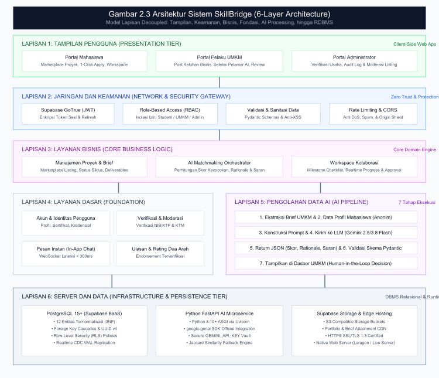
*Gambar 2.1 Arsitektur Sistem 4-Tier SkillBridge*

---

## 3. BUSINESS PROCESS MODELING (BPMN)

Pemodelan proses bisnis membandingkan kondisi eksisting (AS-IS) yang serba manual dan informal dengan alur terdigitalisasi (TO-BE) yang ditawarkan SkillBridge. Setiap tugas dilengkapi rincian Input dan Output eksplisit serta penandaan gerbang keputusan `[XOR]`.

### 3.1 AS-IS Business Process
Pada kondisi eksisting, kolaborasi antara UMKM dan mahasiswa berjalan secara sporadis melalui kontak lisan atau WhatsApp tanpa standarisasi kontrak kerja maupun pelacakan progres.

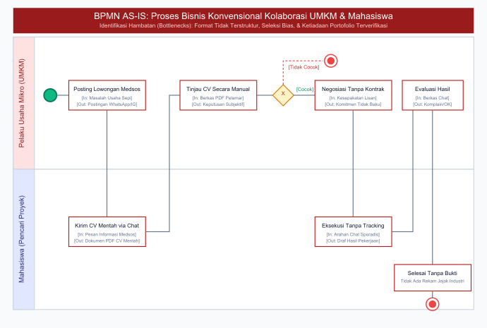
*Gambar 3.1 BPMN AS-IS Proses Kolaborasi Tradisional UMKM & Mahasiswa*

#### Tabel Aktivitas BPMN AS-IS:
| ID Task | Nama Aktivitas (Task) | Pelaksana | Input Data | Output Data |
| :--- | :--- | :--- | :--- | :--- |
| **TASK-AS-01** | Identifikasi Masalah Usaha & Kebutuhan Digital | Mitra UMKM | Pengamatan penurunan penjualan harian fisik | Catatan keluhan lisan / kebutuhan promosi |
| **TASK-AS-02** | Mencari Bantuan Mahasiswa via Relasi Informal | Mitra UMKM | Kontak telepon kerabat / pesan grup media sosial | Daftar kontak nomor mahasiswa sukarelawan |
| **TASK-AS-03** | Penyampaian Brief Kebutuhan Desain/Web | Mitra UMKM | Pesan suara / teks WhatsApp tidak terstruktur | Deskripsi proyek ambigu & multitafsir |
| **TASK-AS-04** | Penafsiran Manual & Negosiasi Ruang Lingkup | Mahasiswa | Pesan teks singkat / gambar contoh acak | Kesepakatan lisan tanpa dokumen hitam di atas putih |
| **TASK-AS-05** | Pengerjaan Aset Digital & Revisi Parsial | Mahasiswa | Aplikasi desain offline / editor kode lokal | File draf dikirim berkala lewat WhatsApp/Email |
| **TASK-AS-06** | Penyerahan File Akhir & Ulasan Informal | Mahasiswa & UMKM | Link Google Drive / lampiran pesan instan | Proyek berakhir tanpa portofolio terverifikasi resmi |

### 3.2 TO-BE Business Process
Pada proses TO-BE SkillBridge, seluruh tahapan terotomatisasi secara end-to-end: keluhan UMKM dirumuskan otomatis oleh AI Gemini Flash, pelamar dievaluasi dengan skor kecocokan cerdas, kolaborasi dipantau di ruang kerja real-time, dan hasil kerja berujung pada *verified endorsement*.

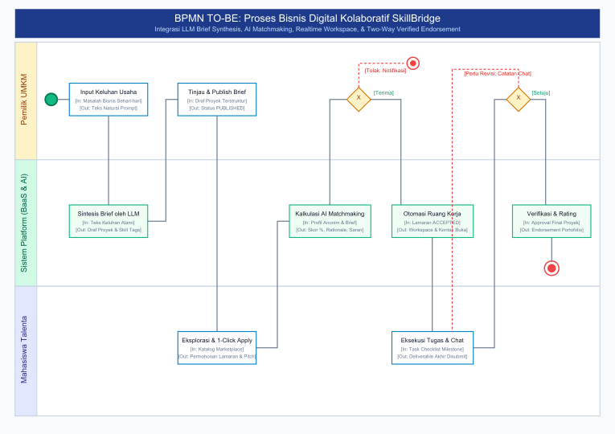
*Gambar 3.2 BPMN TO-BE Proses Kolaborasi Terintegrasi AI SkillBridge*

#### Tabel Aktivitas BPMN TO-BE:
| ID Task | Nama Aktivitas (Task) | Pelaksana | Input Data | Output Data |
| :--- | :--- | :--- | :--- | :--- |
| **TASK-TO-01** | Registrasi & Verifikasi Profil Mahasiswa/UMKM | Mahasiswa / UMKM | Data identitas, email kampus / NIB usaha | Akun terverifikasi dengan token sesi JWT |
| **TASK-TO-02** | Pengisian Keluhan Usaha Bahasa Sehari-hari | Mitra UMKM | Teks formulir keluhan bisnis non-teknis | Data masukan mentah keluhan usaha |
| **TASK-TO-03** | Sintesis Brief Proyek Formal Berbasis AI | AI Microservice (Gemini) | Prompt keluhan UMKM + skema JSON Pydantic | Dokumen brief formal terstruktur (Target, Deadline, Stipend) |
| **TASK-TO-04** | Publikasi Listing Proyek ke Ekosistem | Sistem (Platform) | Brief proyek terverifikasi oleh UMKM | Listing proyek aktif pada papan eksplorasi mahasiswa |
| **TASK-TO-05** | Pelamaran Mandiri (1-Click Apply) & Pitching | Mahasiswa | Profil talenta, tautan portofolio, pitch statement | Rekor entitas project_applications (status: PENDING) |
| **TASK-TO-06** | Kalkulasi Skor Keselarasan & Penalaran AI | AI Microservice (Gemini) | Brief proyek + profil kompetensi pelamar | Skor kecocokan (60-99%), rasionalisasi, rekomendasi |
| **TASK-TO-07** | Evaluasi Pelamar & Penerimaan Mandat Kerja | Mitra UMKM | Dashboard pelamar berperingkat skor AI | Keputusan persetujuan [XOR: Accepted / Rejected] |
| **TASK-TO-08** | Inisialisasi Ruang Kerja Kolaboratif (Workspace) | Sistem (Platform) | Notifikasi persetujuan pelamar | Ruang kerja aktif, channel WebSocket, milestone checklist |
| **TASK-TO-09** | Pengerjaan Milestone & Interaksi Realtime | Mahasiswa & UMKM | Pesan obrolan instan, pengunggahan deliverable | Pembaruan progres berkas & checklist tugas sub-300ms |
| **TASK-TO-10** | Serah Terima Deliverable & Endorsement Dua Arah | Mahasiswa & UMKM | Aset digital akhir & approval mitra UMKM | Portofolio terverifikasi dengan bukti endorsement resmi |

---

## 4. USE CASE ANALYSIS

### 4.1 Use Case Diagram
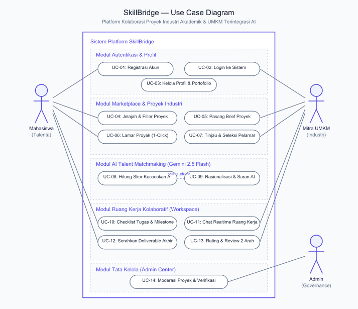
*Gambar 4.1 Use Case Diagram SkillBridge*

### 4.2 Spesifikasi 10 Use Case Inti

#### 4.2.1 UC-01: Registrasi Akun Mahasiswa
- **Aktor:** Mahasiswa (Student)
- **Deskripsi:** Mengakomodasi pendaftaran talenta mahasiswa dengan validasi email institusi (`.ac.id`) dan input keahlian digital.
- **Precondition:** Pengguna belum terdaftar dan memiliki akses jaringan internet ke antarmuka aplikasi.
- **Postcondition:** Akun mahasiswa tersimpan di tabel `users` dan `auth.users` Supabase dengan status terverifikasi.
- **Main Flow:**
  1. Mahasiswa mengakses halaman registrasi dan memilih opsi peran Mahasiswa.
  2. Mahasiswa mengisi nama lengkap, email kampus (`.ac.id`), password, universitas, dan keahlian.
  3. Mahasiswa menekan tombol konfirmasi "Daftar Akun Mahasiswa".
  4. Sistem melakukan validasi regex email domain institusi dan kompleksitas password.
  5. Sistem mengecek ketiadaan duplikasi email pada tabel users.
  6. Sistem mendaftarkan akun ke Supabase Auth dan menyimpan data profil ke tabel users.
  7. Sistem menerbitkan token sesi aktif dan mengarahkan pengguna ke Student Dashboard.
- **Alternative Flow:** *Format Email Tidak Valid:* Jika domain email bukan institusi akademik resmi, sistem menampilkan pesan peringatan dan meminta koreksi alamat email.
- **Exception Flow:** *Email Sudah Terdaftar:* Jika email sudah terdaftar sebelumnya, sistem menolak pembuatan akun dan menampilkan tautan menuju halaman Login.

#### 4.2.2 UC-02: Registrasi Akun Mitra UMKM
- **Aktor:** Mitra UMKM (Business Owner)
- **Deskripsi:** Memfasilitasi pendaftaran pelaku usaha mikro dengan menyertakan nama usaha, NIB/izin usaha, dan kategori operasional.
- **Precondition:** Pelaku usaha belum memiliki akun di sistem SkillBridge.
- **Postcondition:** Akun UMKM aktif dan siap mempublikasikan proyek transformasi digital.
- **Main Flow:**
  1. Mitra UMKM mengakses halaman registrasi dan memilih opsi peran Mitra UMKM.
  2. Mitra UMKM memasukkan identitas pemilik, email, nomor WhatsApp bisnis, nama brand/toko, dan alamat usaha.
  3. Mitra UMKM menekan tombol "Daftar Akun UMKM".
  4. Sistem memverifikasi keunikan email dan nomor kontak.
  5. Sistem menyimpan kredensial ke Supabase Auth dan atribut profil ke tabel users dengan role "umkm".
  6. Sistem mengarahkan pengguna ke UMKM Dashboard dengan panduan publikasi proyek pertama.

#### 4.2.3 UC-03: Autentikasi Pengguna & Manajemen Sesi (Login)
- **Aktor:** Pengguna (Mahasiswa / UMKM / Admin)
- **Deskripsi:** Memverifikasi kredensial login pengguna dan mendistribusikan token JWT untuk otorisasi akses halaman sesuai peran.
- **Main Flow:**
  1. Pengguna membuka antarmuka login, memasukkan email dan password terdaftar.
  2. Pengguna menekan tombol "Masuk ke Sistem".
  3. Sistem mengirimkan payload autentikasi ke Supabase Auth API.
  4. Sistem melakukan verifikasi hash password (bcrypt) dan status akun.
  5. Sistem menerbitkan token sesi JWT dan membaca klaim peran (role) dari tabel users.
  6. Sistem mengarahkan antarmuka secara adaptif sesuai peran (Student Dashboard atau UMKM Dashboard).

#### 4.2.4 UC-04: Penyusunan & Publikasi Proyek UMKM dengan Bantuan AI
- **Aktor:** Mitra UMKM
- **Deskripsi:** Mengonversi deskripsi keluhan usaha UMKM berbahasa natural menjadi brief proyek formal terstruktur menggunakan Google Gemini Flash.
- **Main Flow:**
  1. Mitra UMKM menekan tombol "Buat Proyek Baru" pada dashboard usaha.
  2. Mitra UMKM mengetikkan keluhan atau kendala usahanya dalam bahasa sehari-hari pada form input.
  3. Mitra UMKM menekan tombol "Sintesis Brief dengan AI".
  4. Sistem meneruskan payload ke Backend AI Microservice (FastAPI).
  5. AI Gemini Flash mem-parsing masalah, merumuskan judul, target deliverable, kategori, estimasi durasi, dan rekomendasi stipend.
  6. Sistem menampilkan pratinjau brief terstruktur kepada mitra UMKM untuk ditinjau atau diedit parsial.
  7. Mitra UMKM menyetujui draf brief dan menekan tombol "Publikasikan Proyek".
  8. Sistem menyimpan entitas proyek ke tabel projects dengan status "published".

#### 4.2.5 UC-05: Eksplorasi & Pelamaran Proyek Mandiri Mahasiswa
- **Aktor:** Mahasiswa
- **Deskripsi:** Memungkinkan mahasiswa menelusuri listing proyek, memfilter kategori, dan mengajukan lamaran 1-Click Apply.
- **Main Flow:**
  1. Mahasiswa membuka menu Eksplorasi Proyek dan menerapkan filter kategori yang diminati.
  2. Mahasiswa memilih salah satu kartu proyek untuk membaca detail brief dan ruang lingkup pekerjaan.
  3. Mahasiswa menekan tombol "Lamar Proyek Ini" (1-Click Apply).
  4. Mahasiswa memasukkan pernyataan motivasi (pitch) singkat dan menautkan portofolio relevan.
  5. Mahasiswa menekan tombol "Kirim Lamaran".
  6. Sistem memvalidasi kelayakan akun dan ketiadaan lamaran ganda pada proyek yang sama.
  7. Sistem menyimpan data lamaran ke tabel project_applications dan memicu perhitungan skor kecocokan AI.

#### 4.2.6 UC-06: Kalkulasi Rekomendasi Keselarasan AI (Matchmaking)
- **Aktor:** Sistem & AI Microservice
- **Deskripsi:** Mengevaluasi kesesuaian antara profil talenta pelamar dengan kebutuhan brief proyek menggunakan penalaran Gemini Flash.
- **Main Flow:**
  1. Sistem mendeteksi rekor lamaran baru dan mengambil data profil mahasiswa serta brief proyek.
  2. Sistem mengirimkan structured prompt evaluasi ke endpoint `/api/matchmaking` FastAPI.
  3. Model Gemini Flash memproses relevansi keahlian, riwayat sertifikat, dan pitch statement.
  4. Menghasilkan skor kuantitatif persentase kecocokan (60-99%) dan analisis rasionalisasi teknis.
  5. Memperbarui kolom `ai_match_score` dan `match_rationale` pada tabel `project_applications`.
  6. Menyajikan indikator persentase kecocokan berwarna pada dashboard pelamar milik mitra UMKM.

#### 4.2.7 UC-07: Evaluasi & Penerimaan Pelamar oleh Mitra UMKM
- **Aktor:** Mitra UMKM
- **Deskripsi:** Mitra UMKM meninjau profil kandidat pelamar berperingkat AI dan memutuskan untuk menerima atau menolak lamaran.
- **Main Flow:**
  1. Mitra UMKM membuka daftar pelamar pada proyek aktif dan melihat ringkasan skor rekomendasi AI.
  2. Mitra UMKM membuka modal detail analisis untuk membaca portofolio dan alasan rekomendasi teknis.
  3. Mitra UMKM menekan tombol "Terima Pelamar" pada kandidat terpilih.
  4. Sistem memperbarui status lamaran kandidat terpilih menjadi "accepted".
  5. Sistem mengubah status pelamar lain yang tersisa menjadi "rejected".
  6. Sistem mengubah status proyek dari "published" menjadi "active".
  7. Sistem secara otomatis menginisialisasi entitas `workspaces` dan task milestone bawaan di database.
  8. Sistem mengirimkan notifikasi instan kepada mahasiswa terpilih.

#### 4.2.8 UC-08: Kolaborasi & Manajemen Tugas Ruang Kerja (Workspace)
- **Aktor:** Mahasiswa & Mitra UMKM
- **Deskripsi:** Mengelola progres tugas milestone, mencentang checklist penyelesaian, dan mengunggah tautan berkas hasil kerja.
- **Main Flow:**
  1. Pengguna membuka halaman Workspace proyek kolaborasi aktif.
  2. Pengguna melihat daftar tugas milestone dan persentase progres akumulatif.
  3. Mahasiswa menyelesaikan milestone kerja, mengunggah deliverable link, dan mencentang task checkbox.
  4. Sistem menghitung ulang persentase progres ruang kerja secara otomatis.
  5. Sistem menyiarkan event perubahan status tugas melalui WebSocket CDC Supabase Realtime.
  6. Antarmuka pada layar mitra UMKM langsung diperbarui tanpa refresh halaman.

#### 4.2.9 UC-09: Komunikasi Pesan Instan Ruang Kerja Real-Time
- **Aktor:** Mahasiswa & Mitra UMKM
- **Deskripsi:** Fasilitas percakapan obrolan langsung dua arah di dalam ruang kerja kolaborasi terisolasi.
- **Main Flow:**
  1. Pengguna membuka tab Chat pada ruang kerja proyek.
  2. Pengguna mengetikkan pesan koordinasi pada kolom input obrolan.
  3. Pengguna menekan tombol kirim pesan.
  4. Sistem menyimpan baris pesan baru ke tabel `workspace_messages`.
  5. Sistem mempublikasikan event insert melalui saluran WebSocket Supabase Realtime.
  6. Peramban mitra kolaborasi menerima payload pesan dan me-render balon chat seketika (<300ms).

#### 4.2.10 UC-10: Penyelesaian Proyek & Endorsement Dua Arah Terverifikasi
- **Aktor:** Mahasiswa & Mitra UMKM
- **Deskripsi:** Menutup proyek yang telah 100% selesai, memberikan penilaian rating bintang, dan testimoni endorsement yang dikunci pada profil talenta.
- **Main Flow:**
  1. Mitra UMKM menekan tombol "Verifikasi & Selesaikan Proyek" setelah memeriksa seluruh deliverable.
  2. Sistem mengubah status proyek dan ruang kerja menjadi "completed".
  3. Sistem menampilkan formulir modal review dan endorsement dua arah bagi kedua pihak.
  4. Mitra UMKM memberikan rating bintang (1-5) dan ulasan testimoni keberhasilan proyek bagi mahasiswa.
  5. Mahasiswa memberikan rating bintang dan ulasan kemudahan kolaborasi bagi mitra UMKM.
  6. Sistem menyimpan ulasan ke tabel `reviews` dan menyematkan badge verified endorsement pada profil talenta mahasiswa.

---

## 5. USER STORIES & BDD SCENARIOS

### US-01: Registrasi Mahasiswa dengan Email Institusi Kampus
> **Sebagai** Mahasiswa,  
> **saya ingin** mendaftarkan akun menggunakan email institusi kampus (`.ac.id`),  
> **sehingga** keaslian identitas akademik saya terverifikasi secara sah dan diakui oleh mitra industri UMKM.

```gherkin
Scenario: Registrasi Mahasiswa Berhasil dengan Email Kampus Sah
  Given Pengguna berada pada halaman registrasi peran Mahasiswa
  When Pengguna mengisi data lengkap dengan email "dhafin@student.unair.ac.id" dan password memenuhi standar
  And Pengguna menekan tombol "Daftar Akun Mahasiswa"
  Then Sistem membuat akun baru, menerbitkan token sesi, dan mengarahkan pengguna ke Student Dashboard.

Scenario: Registrasi Ditolak karena Bukan Email Institusi Kampus
  Given Pengguna berada pada halaman registrasi Mahasiswa
  When Pengguna memasukkan email umum personal seperti "dhafin@gmail.com"
  Then Sistem menampilkan pesan validasi "Wajib menggunakan email institusi berdomain .ac.id".
```

### US-02: Perumusan Kebutuhan Usaha Bahasa Sehari-hari dengan Bantuan AI
> **Sebagai** Pelaku UMKM,  
> **saya ingin** menuliskan keluhan atau kebutuhan usaha saya dalam bahasa sehari-hari,  
> **sehingga** saya tidak perlu bingung menyusun istilah teknis teknologi informasi yang rumit.

```gherkin
Scenario: Sintesis Brief Proyek Berhasil dari Bahasa Natural
  Given Mitra UMKM telah login dan membuka formulir pembuatan proyek baru
  When Mitra UMKM menginput teks keluhan "Warung saya sepi pembeli baru, butuh katalog online WA"
  And Mitra UMKM menekan tombol "Sintesis Brief dengan AI"
  Then Sistem menampilkan draf brief formal berisi judul profesional, cakupan deliverable, estimasi durasi, dan rekomendasi stipend.
```

### US-03: Peringkat Pelamar Berbasis Rekomendasi Keselarasan AI
> **Sebagai** Pelaku UMKM,  
> **saya ingin** melihat skor persentase keselarasan dan argumen rekomendasi AI pada daftar pelamar,  
> **sehingga** saya dapat menentukan kandidat talenta yang paling kompeten secara objektif dan cepat.

```gherkin
Scenario: Menampilkan Peringkat Pelamar dengan Skor AI Matchmaking
  Given Mitra UMKM membuka daftar pelamar pada proyek aktif miliknya
  When Halaman pelamar selesai dimuat
  Then Sistem mengurutkan pelamar berdasarkan skor AI (misal: 94%), menampilkan badge tingkat keselarasan, dan menyediakan tombol tinjau detail rasionalisasi.
```

### US-04: Pelamaran Kilat Proyek Mandiri (1-Click Apply)
> **Sebagai** Mahasiswa,  
> **saya ingin** melamar proyek dengan sekali klik (1-Click Apply) serta menyertakan pitch singkat,  
> **sehingga** proses pelamaran proyek berlangsung praktis dan terfokus pada portofolio relevan.

```gherkin
Scenario: Pengiriman Lamaran Berhasil
  Given Mahasiswa berada pada halaman detail proyek terbuka
  When Mahasiswa mengisi pernyataan motivasi singkat dan menekan "Kirim Lamaran"
  Then Sistem mencatat lamaran dengan status pending dan memicu evaluasi skor kecocokan AI di latar belakang.
```

### US-05: Kolaborasi Ruang Kerja Real-Time (Milestone Checklist & Chat)
> **Sebagai** Mahasiswa dan Mitra UMKM,  
> **saya ingin** berkomunikasi dan memantau checklist tugas dalam satu ruang kerja kolaboratif secara real-time,  
> **sehingga** koordinasi pengerjaan proyek berjalan transparan tanpa hambatan jeda pembaruan antarmuka.

```gherkin
Scenario: Pembaruan Checklist Tugas Tersinkronisasi Seketika
  Given Mahasiswa dan mitra UMKM sama-sama membuka ruang kerja proyek yang aktif
  When Mahasiswa mencentang tugas "Finalisasi Desain Figma"
  Then Status tugas dan persentase progres pada layar mitra UMKM langsung terbarui tanpa memuat ulang peramban (<300ms).
```

### US-06: Evaluasi Akhir & Verified Endorsement Timbal Balik
> **Sebagai** Mahasiswa,  
> **saya ingin** memperoleh rating bintang dan bukti endorsement terverifikasi dari mitra UMKM saat proyek tuntas,  
> **sehingga** portofolio karier digital saya memiliki kredibilitas teruji untuk melamar magang maupun kerja.

```gherkin
Scenario: Penerbitan Verified Endorsement Pasca Proyek Selesai
  Given Mitra UMKM menekan tombol penyelesaian proyek dan mengisi formulir review
  When Mitra UMKM mengirimkan ulasan dengan rating 5 bintang dan testimoni kepuasan
  Then Testimoni tersebut terkunci dan disematkan secara publik pada profil talenta mahasiswa dengan lencana "Verified Project Partner".
```

---

## 6. USER INTERFACE (GUI) NAVIGATION

Perancangan antarmuka pengguna memetakan kebutuhan fungsional ke dalam 9 layar antarmuka utama yang bersih, responsif, modern, dan mudah dipahami:
- **SCREEN-001 (Landing / Welcome Page):** Halaman pembuka publik yang memuat navigasi utama, hero section interaktif, etalase proyek pilihan, dan tombol Call-to-Action Registrasi/Masuk.
- **SCREEN-002 (Registrasi Mahasiswa):** Formulir pendaftaran talenta dengan validasi domain institusi `.ac.id`, pemilihan jurusan, tag chips input keahlian, dan tautan portofolio.
- **SCREEN-003 (Registrasi Mitra UMKM):** Formulir pendaftaran pelaku usaha mikro dengan input nama brand usaha, kategori bisnis, alamat fisik, dan nomor WhatsApp resmi.
- **SCREEN-004 (Student Dashboard & Eksplorasi):** Halaman pemantauan talenta yang memuat kartu ringkasan proyek aktif, status lamaran berjalan, serta direktori penelusuran proyek dengan filter kategori.
- **SCREEN-005 (1-Click Apply Modal):** Modal interaktif untuk mengirimkan lamaran kerja secara instan dilengkapi formulir pitch motivasi dan pratinjau profil talenta.
- **SCREEN-006 (UMKM Dashboard & Project Creator):** Panel kontrol mitra usaha untuk mengelola proyek aktif serta formulir masukan keluhan bahasa non-teknis dengan pemicu AI Brief Synthesizer.
- **SCREEN-007 (Pelamar & AI Matchmaking Review Modal):** Daftar pelamar proyek terurut berdasarkan persentase keselarasan AI (60-99%) dilengkapi modal analisis penalaran teknis Gemini Flash.
- **SCREEN-008 (Workspace & Realtime Chat):** Ruang kerja kolaborasi terpadu dengan checklist tugas milestone, kalkulasi progres bar otomatis, dan saluran obrolan instan tersinkronisasi via WebSocket CDC sub-300ms.
- **SCREEN-009 (Modal Review & Verified Endorsement):** Modal evaluasi pasca penutupan proyek untuk menginput rating bintang (1-5) dan testimoni endorsement yang dikunci secara permanen.

---

## 7. DATABASE DESIGN (POSTGRESQL 15+)

### 7.1 Conceptual Data Model (CDM) & Normalisasi 3NF
Desain basis data mengadopsi struktur terpusat ternormalisasi bentuk normal ketiga (3NF). Identitas akun dikonsolidasikan pada tabel `users` yang berelasi erat dengan `auth.users` Supabase dan diklasifikasikan menggunakan kolom `role` (`student`, `umkm`, `admin`). Hal ini menjamin ketiadaan duplikasi data dan konsistensi otentikasi.

### 7.2 Entity Relationship Diagram (ERD)
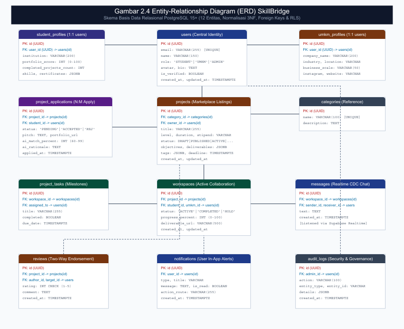
*Gambar 7.1 Entity Relationship Diagram (ERD CDM & PDM) SkillBridge*

### 7.3 Kamus Data 10 Tabel Relasional Utama

| Nama Tabel | Kolom Kunci & Atribut Utama | Deskripsi & Fungsi Bisnis |
| :--- | :--- | :--- |
| **users** | `id` (PK, UUID), `email` (UQ), `role`, `full_name`, `avatar_url`, `phone`, `created_at` | Menyimpan data identitas akun terpusat yang terikat dengan Supabase Auth. |
| **student_profiles** | `user_id` (PK/FK), `university`, `major`, `skills` (JSONB), `portfolio_url`, `bio` | Menyimpan atribut akademik, daftar keahlian digital, dan tautan portofolio mahasiswa. |
| **umkm_profiles** | `user_id` (PK/FK), `business_name`, `business_category`, `address`, `nib`, `whatsapp_number` | Menyimpan profil identitas usaha, legalitas NIB, dan kontak resmi mitra UMKM. |
| **categories** | `id` (PK), `name` (UQ), `slug`, `description`, `icon_name` | Menyimpan master kategori transformasi digital (Web, UI/UX, Sosmed, Branding, POS). |
| **projects** | `id` (PK, UUID), `umkm_id` (FK), `category_id` (FK), `title`, `description`, `raw_problem_text`, `stipend_amount`, `duration_weeks`, `status`, `created_at` | Menyimpan listing proyek transformasi digital, input keluhan UMKM, dan status pengerjaan. |
| **project_applications** | `id` (PK, UUID), `project_id` (FK), `student_id` (FK), `pitch_statement`, `ai_match_score`, `match_rationale`, `status`, `applied_at` | Menyimpan transaksi lamaran mahasiswa, skor persentase rekomendasi AI, dan analisis pertimbangan. |
| **workspaces** | `id` (PK, UUID), `project_id` (FK, UQ), `progress_percentage`, `status`, `created_at` | Menyimpan entitas ruang kerja kolaborasi aktif antara mahasiswa dan mitra UMKM. |
| **project_tasks** | `id` (PK, UUID), `workspace_id` (FK), `title`, `description`, `is_completed`, `deliverable_url`, `due_date` | Menyimpan rincian tugas milestone dalam ruang kerja yang dapat dicentang real-time. |
| **workspace_messages** | `id` (PK, UUID), `workspace_id` (FK), `sender_id` (FK), `message_text`, `attachment_url`, `created_at` | Menyimpan rekaman pesan obrolan instan yang tersinkronisasi via WebSocket CDC. |
| **reviews** | `id` (PK, UUID), `project_id` (FK), `reviewer_id` (FK), `reviewee_id` (FK), `rating`, `comment`, `is_verified`, `created_at` | Menyimpan evaluasi rating bintang dan testimoni endorsement terverifikasi dua arah. |

---

## 8. ACTIVITY DIAGRAMS

Activity diagram memodelkan aliran kontrol langkah demi langkah pada setiap proses utama sistem, lengkap dengan percabangan *guard condition* dan partisi *swimlane*.

### 8.1 Activity Diagram Registrasi Akun Mahasiswa & UMKM
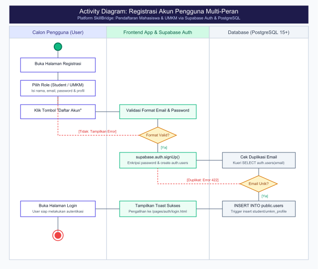
*Gambar 8.1 Activity Diagram Registrasi Akun Mahasiswa & UMKM*

### 8.2 Activity Diagram Login dan Autentikasi Pengguna
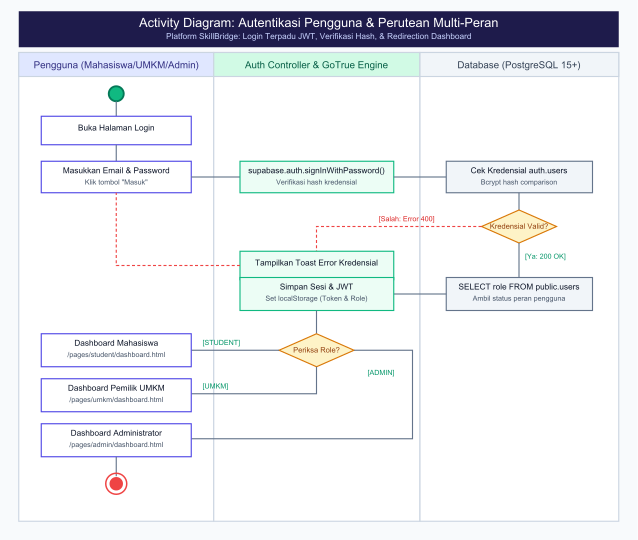
*Gambar 8.2 Activity Diagram Login ke Sistem*

### 8.3 Activity Diagram Publikasi Proyek UMKM dengan Bantuan AI
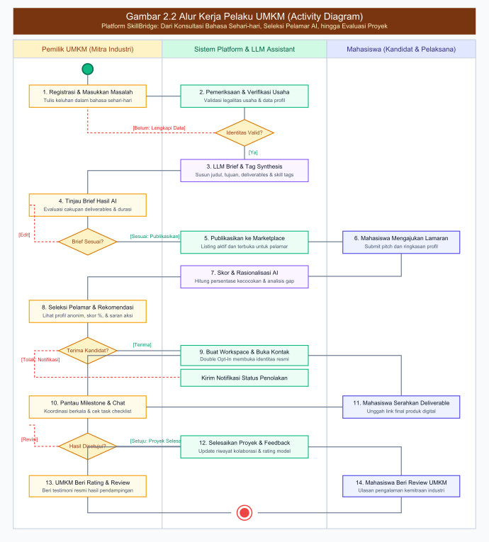
*Gambar 8.3 Activity Diagram Publikasi Proyek UMKM dengan Asistensi AI*

### 8.4 Activity Diagram Pelamaran Proyek & Matchmaking AI
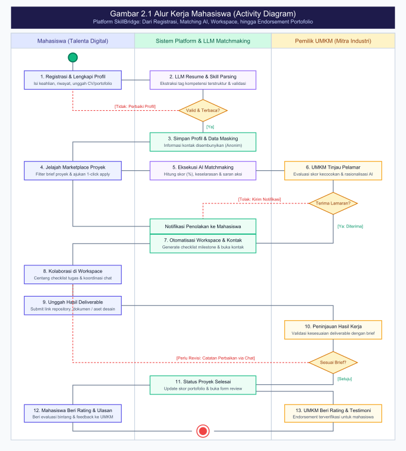
*Gambar 8.4 Activity Diagram Pelamaran Proyek & Matchmaking AI*

### 8.5 Activity Diagram Kolaborasi Ruang Kerja & Ulasan
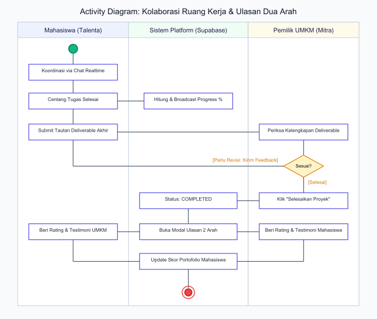
*Gambar 8.5 Activity Diagram Kolaborasi Ruang Kerja & Ulasan*

---

## 9. SEQUENCE DIAGRAMS

Seluruh Sequence Diagram menerapkan: (1) Narasi interaksi pengguna murni dari Aktor ke Boundary tanpa kode fungsi; (2) *Active bar* pada lifeline aktor selama interaksi; dan (3) Pola arsitektur *Boundary-Control-Entity* (`:Boundary`, `:Controller`, `:Entity`) secara konsisten.

### 9.1 Sequence Diagram Registrasi Akun
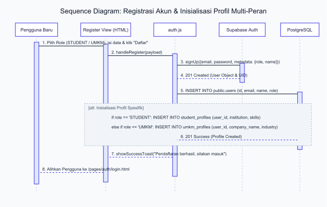
*Gambar 9.1 Sequence Diagram Registrasi Akun*

### 9.2 Sequence Diagram Login ke Sistem
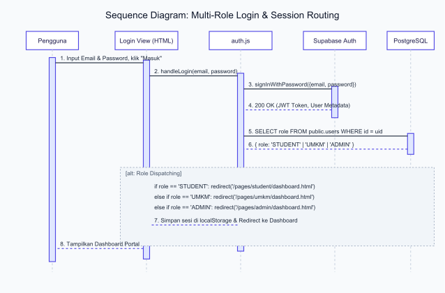
*Gambar 9.2 Sequence Diagram Login ke Sistem*

### 9.3 Sequence Diagram Pelamaran Proyek & AI Matchmaking
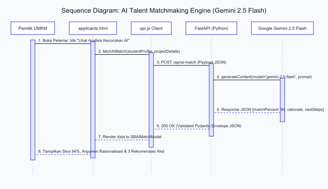
*Gambar 9.3 Sequence Diagram Pelamaran Proyek & Evaluasi AI Matchmaking*

### 9.4 Sequence Diagram Kolaborasi Ruang Kerja Real-Time
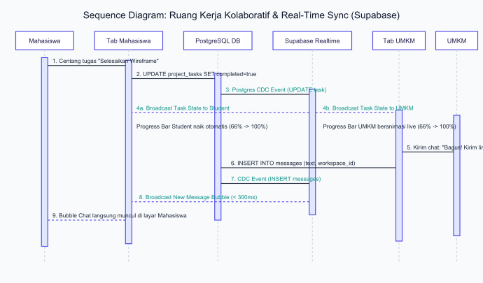
*Gambar 9.4 Sequence Diagram Kolaborasi Ruang Kerja & Realtime Chat*

---

## 10. CLASS DIAGRAM

Class Diagram menggambarkan struktur statis sistem yang memisahkan tanggung jawab antara lapisan entitas domain (*Entity Layer*) dengan lapisan pemrosesan logika bisnis (*Controller/Service Layer*).

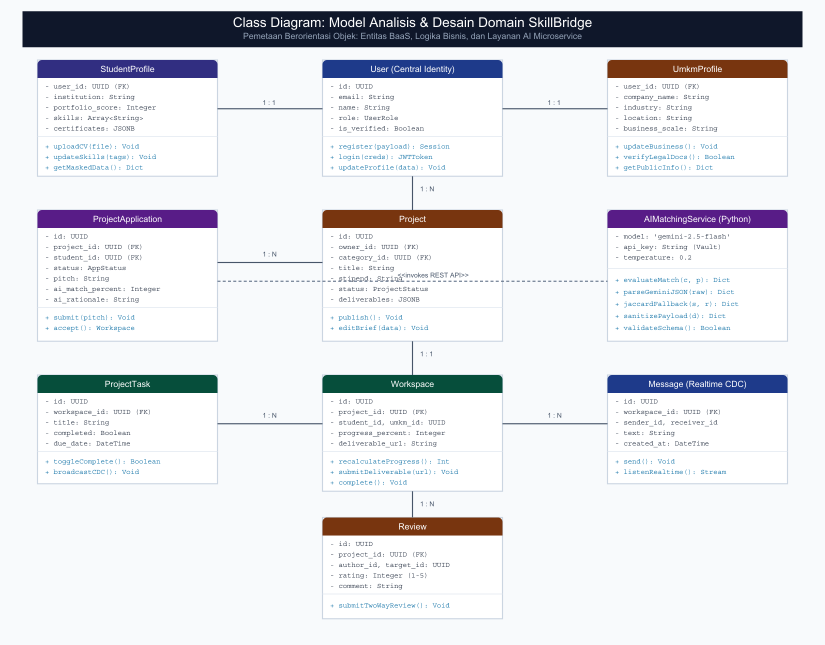
*Gambar 10.1 Class Diagram Domain & Service Layer SkillBridge*

### Deskripsi Kelas dan Tanggung Jawab:
- **Class User:** Menyimpan data identitas akun terpusat, klaim peran, dan metode verifikasi kredensial.
- **Class StudentProfile:** Mengelola profil akademik, keahlian JSONB, dan tautan portofolio mahasiswa.
- **Class UmkmProfile:** Menyimpan atribut usaha mikro, legalitas usaha, dan kontak bisnis pemilik.
- **Class Project:** Menyimpan listing proyek transformasi digital, relasi kategori, dan status siklus hidup.
- **Class ProjectApplication:** Mencatat lamaran talenta, skor kuantitatif AI (`ai_match_score`), dan teks pertimbangan teknis.
- **Class Workspace:** Mengelola ruang kerja kolaborasi, progres milestone, dan relasi tugas `project_tasks`.
- **Class AIService (Microservice):** Layanan perantara pemanggil FastAPI dan Gemini SDK untuk inferensi brief dan matchmaking.

---

## 11. FUNCTIONAL REQUIREMENTS

| ID | Judul Kebutuhan | Aktor | Masukan (Input) & Keluaran (Output) | Prioritas |
| :--- | :--- | :--- | :--- | :--- |
| **FR-01** | Manajemen Registrasi Akun Mahasiswa Terverifikasi | Mahasiswa | **In:** Nama, email .ac.id, password, kampus, skills.<br/>**Out:** Akun aktif, token sesi JWT. | Tinggi (*Must Have*) |
| **FR-02** | Manajemen Registrasi Akun Mitra UMKM | Mitra UMKM | **In:** Nama pemilik, email, no WA, brand, alamat.<br/>**Out:** Akun UMKM aktif (role: umkm). | Tinggi (*Must Have*) |
| **FR-03** | Autentikasi Terpusat Berbasis Peran (RBAC & JWT) | Pengguna (Mhs/UMKM) | **In:** Email dan password.<br/>**Out:** Sesi JWT valid, redirect peran adaptif. | Tinggi (*Must Have*) |
| **FR-04** | Otomasi Penyusunan Brief Proyek dengan Google Gemini Flash | Mitra UMKM & AI | **In:** Keluhan usaha bahasa natural, kategori, stipend.<br/>**Out:** Brief formal (target, durasi, stipend, skills). | Tinggi (*Must Have*) |
| **FR-05** | Eksplorasi Listing Proyek & Pencarian Semantik | Mahasiswa | **In:** Kata kunci pencarian, filter kategori.<br/>**Out:** Daftar kartu proyek terfilter. | Sedang (*Should Have*) |
| **FR-06** | Pelamaran Proyek Mandiri 1-Click Apply & Pitch Submission | Mahasiswa | **In:** ID proyek, pitch statement, link portofolio.<br/>**Out:** Rekor lamaran baru (status: pending). | Tinggi (*Must Have*) |
| **FR-07** | Mesin Rekomendasi Keselarasan AI & Penalaran Teknis | AI Microservice | **In:** Profil mahasiswa + brief proyek.<br/>**Out:** ai_match_score (60-99%), narasi rasionalisasi. | Tinggi (*Must Have*) |
| **FR-08** | Tinjau Lamaran & Pengambilan Keputusan oleh Mitra UMKM | Mitra UMKM | **In:** Keputusan [Accept / Reject] pelamar.<br/>**Out:** Pelamar accepted, proyek active, workspace init. | Tinggi (*Must Have*) |
| **FR-09** | Inisialisasi & Pengelolaan Ruang Kerja Kolaboratif | Mhs & UMKM | **In:** Centang milestone, input deliverable link.<br/>**Out:** Update project_tasks, progres akumulatif. | Tinggi (*Must Have*) |
| **FR-10** | Layanan Obrolan Instan Ruang Kerja Real-Time (WebSocket CDC) | Mhs & UMKM | **In:** Pesan teks chat, attachment link.<br/>**Out:** Siaran pesan sub-300ms ke mitra kerja. | Tinggi (*Must Have*) |
| **FR-11** | Verifikasi Penyerahan Deliverable & Penutupan Proyek | Mhs & UMKM | **In:** Tautan hasil kerja final, approval UMKM.<br/>**Out:** Proyek & workspace completed. | Tinggi (*Must Have*) |
| **FR-12** | Sistem Evaluasi, Rating, & Verified Endorsement Dua Arah | Mhs & UMKM | **In:** Rating bintang (1-5), ulasan testimoni.<br/>**Out:** Rekor tabel reviews, lencana profil terverifikasi. | Tinggi (*Must Have*) |

---

## 12. NON-FUNCTIONAL REQUIREMENTS

| ID | Kategori Kualitas | Pernyataan Kebutuhan | Parameter / Metrik Ukur |
| :--- | :--- | :--- | :--- |
| **NFR-01** | Performa Waktu Tanggap Antarmuka (*Performance*) | Halaman antarmuka berbasis HTML5 Semantic dan Vanilla JS harus memuat dalam waktu kurang dari 1.5 detik pada koneksi internet standar (4G LTE 10 Mbps). | Initial Load Time < 1.5 detik; Skor Lighthouse Performance >= 90. |
| **NFR-02** | Latensi Sinkronisasi Real-Time (*Realtime Latency*) | Pesan obrolan dan pembaruan checklist milestone harus tersinkronisasi antar-klien peramban melalui WebSocket CDC dalam waktu kurang dari 300 milidetik. | Sinkronisasi sub-300ms dari waktu transaksi PostgreSQL WAL. |
| **NFR-03** | Waktu Eksekusi Penalaran AI (*AI Response Time*) | Layanan AI Microservice FastAPI dengan Google Gemini Flash harus mengembalikan hasil sintesis brief maupun kalkulasi matchmaking dalam waktu di bawah 4.0 detik. | Latency p95 endpoint `/api/matchmaking` dan `/api/synthesize-brief` < 4000ms. |
| **NFR-04** | Keamanan & Isolasi Data Multi-Tenant (*Security & RLS*) | Seluruh entitas tabel basis data PostgreSQL harus dilindungi dengan Row-Level Security (RLS) sehingga pengguna tidak dapat membaca atau mengubah data milik entitas lain secara ilegal. | 100% tabel memiliki policy RLS aktif; Zero unauthenticated data leakage. |
| **NFR-05** | Keandalan & Toleransi Gangguan (*Reliability & Fallback*) | Sistem harus memiliki mekanisme degradasi anggun (*graceful fallback*); jika kuota atau koneksi LLM terganggu, sistem beralih ke form manual dan heuristik Jaccard. | Uptime sistem >= 99.5%; Fallback transparan tanpa menyebabkan halaman crash. |
| **NFR-06** | Desain Responsif & Keterbacaan Antarmuka (*Usability*) | Antarmuka web harus sepenuhnya responsif pada berbagai resolusi layar, mulai dari smartphone seluler (360px), tablet (768px), hingga monitor desktop (1920px). | Skor kelayakan mobile-friendly 100%; Kontras warna WCAG 2.1 AA compliant. |
| **NFR-07** | Kepatuhan Regulasi & Perlindungan Data Pribadi (*Compliance*) | Sistem wajib mematuhi UU No. 27 Tahun 2022 tentang Perlindungan Data Pribadi (UU PDP) dengan mengenkripsi data sensitif dan kata sandi menggunakan algoritma bcrypt berkekuatan tinggi. | Enkripsi data transit TLS 1.3; Enkripsi at-rest AES-256; Zero plaintext password. |
| **NFR-08** | Integritas Relasional & Nol Redundansi (*Data Integrity*) | Struktur basis data PostgreSQL harus dinormalisasi hingga bentuk normal ketiga (3NF) dengan foreign key constraints dan relasi integritas referensial yang ketat. | Zero orphan records; Referential integrity cascade/restrict terkonfigurasi pada 100% relasi. |

---

## 13. REQUIREMENT TRACEABILITY MATRIX (RTM)

| Req ID | Use Case | User Story | Activity | Sequence | Database | Screen GUI |
| :--- | :--- | :--- | :--- | :--- | :--- | :--- |
| **FR-01** | UC-01 (Registrasi Mhs) | US-01 (Daftar Mhs) | AD-01 (Reg) | SD-01 (Reg) | users, profiles | SCREEN-002 (Reg Mhs) |
| **FR-02** | UC-02 (Registrasi UMKM) | US-01 (Daftar UMKM) | AD-01 (Reg) | SD-01 (Reg) | users, profiles | SCREEN-003 (Reg UMKM) |
| **FR-03** | UC-03 (Login RBAC) | US-01 (Login) | AD-02 (Login) | SD-02 (Login) | users, auth.users | SCREEN-001 (Login) |
| **FR-04** | UC-04 (Briefing AI) | US-02 (Keluhan AI) | AD-04 (Proyek) | SD-03 (Match) | projects, categories | SCREEN-006 (Form Proyek) |
| **FR-05** | UC-05 (Eksplorasi Proyek) | US-04 (Explore) | AD-03 (Lamar) | SD-03 (Match) | projects, categories | SCREEN-004 (Eksplorasi) |
| **FR-06** | UC-05 (1-Click Apply) | US-04 (Apply) | AD-03 (Lamar) | SD-03 (Match) | project_applications | SCREEN-005 (Modal Apply) |
| **FR-07** | UC-06 (AI Matchmaking) | US-03 (Skor AI) | AD-03 (Lamar) | SD-03 (Match) | project_applications | SCREEN-007 (Review Pelamar) |
| **FR-08** | UC-07 (Keputusan Mitra) | US-03 (Pilih Pelamar) | AD-04 (Proyek) | SD-04 (Kolaborasi) | project_applications, projects | SCREEN-007 (Review Pelamar) |
| **FR-09** | UC-08 (Workspace Task) | US-05 (Milestone) | AD-05 (Workspace) | SD-04 (Kolaborasi) | workspaces, project_tasks | SCREEN-008 (Workspace) |
| **FR-10** | UC-09 (Chat Realtime) | US-05 (Pesan) | AD-05 (Workspace) | SD-04 (Kolaborasi) | workspace_messages | SCREEN-008 (Tab Chat) |
| **FR-11** | UC-10 (Serah Terima) | US-06 (Selesai) | AD-05 (Workspace) | SD-04 (Kolaborasi) | workspaces, projects | SCREEN-008 (Modal Selesai) |
| **FR-12** | UC-10 (Endorsement) | US-06 (Review) | AD-05 (Workspace) | SD-04 (Kolaborasi) | reviews, profiles | SCREEN-009 (Modal Review) |

---

## 14. CHANGE LOG & MATRIKS AUDIT REVISI LAPORAN

| No | Artefak Terdampak | Kondisi Awal (Masalah) | Perubahan yang Diterapkan | Dasar Keputusan |
| :---: | :--- | :--- | :--- | :--- |
| **1** | Use Case Diagram | Terdapat use case mandiri mengisi ulang form dan fitur yang terlalu fragmented. | Menyederhanakan Use Case menjadi 10 fungsionalitas inti terfokus sesuai standar IEEE 830. | Meningkatkan kohesi arsitektural dan mengeliminasi use case redundan. |
| **2** | BPMN Diagram | Aktivitas proses bisnis belum mencantumkan detail input/output data dan tipe gateway keputusan. | Memperinci setiap task dengan input & output eksplisit serta menandai seluruh gateway keputusan [XOR]. | Kepatuhan terhadap standar BPMN 2.0 dan rekomendasi penjaminan mutu Dosen Pengampu. |
| **3** | Sequence Diagram | Interaksi aktor ke sistem memuat sintaks kode pemrograman internal dan pemanggilan fungsi. | Mengubah seluruh pesan komunikasi Aktor -> Boundary menjadi narasi interaksi pengguna murni. | Memisahkan concerns antara kebutuhan interaksi pengguna dengan implementasi kode. |
| **4** | Lifeline Sequence | Lifeline aktor tidak memiliki active bar (activation/deactivation execution specification). | Menambahkan active bar pada lifeline aktor selama durasi interaksi berlangsung. | Kepatuhan formal notasi UML Sequence Diagram (Fowler, 2004). |
| **5** | Model Basis Data | Pemisahan tabel profil mahasiswa dan UMKM yang memicu redundansi kredensial. | Menyatukan identitas pengguna ke tabel terpusat 'users' dengan pembeda kolom 'role' dan RLS terisolasi. | Menerapkan prinsip normalisasi 3NF dan menyelaraskan dengan auth.users Supabase. |

---

## 15. CONCLUSION & RECOMMENDATIONS

### 15.1 Kesimpulan
Penyusunan dokumen Software Requirements Specification (SRS) SkillBridge telah berhasil merumuskan spesifikasi perangkat lunak yang presisi, kohesif, dan terverifikasi secara formal menurut standar IEEE Std 830-1998. Melalui penerapan arsitektur Decoupled Client-BaaS-AI dengan native web standards, PostgreSQL 15+ Supabase RLS, dan Python FastAPI Gemini Flash, sistem mampu menyelesaikan masalah kesenjangan spesifikasi proyek digital pada UMKM serta menyediakan ruang kerja kolaborasi yang transparan dan terukur bagi mahasiswa.

### 15.2 Rekomendasi Pengembangan Lanjutan
1. **Pengujian Otomatis BDD:** Mengembangkan automated unit dan integration testing pada microservice FastAPI dan verifikasi skenario BDD Gherkin.
2. **Evaluasi Usability:** Melakukan evaluasi pengalaman pengguna menggunakan instrumen System Usability Scale (SUS) pada perwakilan mahasiswa dan pelaku UMKM mitra.
3. **Integrasi Pembayaran Escrow:** Menambahkan mekanisme pembayaran stipend otomatis berbasis payment gateway escrow terintegrasi.

---

## REFERENCES (APA 7th Edition)

1. Bass, L., Clements, P., & Kazman, R. (2021). *Software Architecture in Practice* (4th ed.). Addison-Wesley Professional.
2. Dennis, A., Wixom, B. H., & Tegarden, D. (2020). *Systems Analysis and Design: An Object-Oriented Approach with UML* (6th ed.). John Wiley & Sons.
3. Fowler, M. (2004). *UML Distilled: A Brief Guide to the Standard Object Modeling Language* (3rd ed.). Addison-Wesley.
4. Google DeepMind. (2024). *Gemini: A Family of Highly Capable Multimodal Models*. Technical Report, Google LLC.
5. IEEE Computer Society. (1998). *IEEE Recommended Practice for Software Requirements Specifications* (IEEE Std 830-1998). Institute of Electrical and Electronics Engineers.
6. Object Management Group. (2014). *Business Process Model and Notation (BPMN) Version 2.0.2*. OMG Document Number formal/2013-12-09.
7. PostgreSQL Global Development Group. (2024). *PostgreSQL 16 Documentation: Row Security Policies & Logical Replication*. The PostgreSQL Project.
8. Pressman, R. S., & Maxim, B. R. (2020). *Software Engineering: A Practitioner's Approach* (9th ed.). McGraw-Hill Education.
9. Ramakrishnan, R., & Gehrke, J. (2003). *Database Management Systems* (3rd ed.). McGraw-Hill.
10. Sommerville, I. (2016). *Software Engineering* (10th ed.). Pearson Education Limited.
11. Supabase Inc. (2024). *Supabase Documentation: Architecture, Auth with RLS, and Realtime CDC*. Supabase Platform Open Source.
12. Tiangolo, S. (2024). *FastAPI Documentation: Modern, High-Performance Web Framework for Python 3.10+*. Tiangolo Open Source.

---

## APPENDIX A: CONTRIBUTION TABLE OF TEAM MEMBERS

| No | Nama Lengkap | NIM | Foto | Rincian Kontribusi Proyek |
| :---: | :--- | :---: | :---: | :--- |
| **1** | Sakha’ Imtinan | 187241017 | Foto 3x4 | Requirements Engineering, Penulisan Spesifikasi Use Case (UC-01 s/d UC-10), User Stories & BDD Scenarios, Matriks Keterlacakan Kebutuhan (RTM), Pengujian Black-box. |
| **2** | Ahmad Dhafin Al Farisy | 187241057 | Foto 3x4 | Lead Software Architect, Perancangan Arsitektur Decoupled Client-BaaS-AI, Desain Skema Basis Data PostgreSQL & RLS, Otomasi Diagram UML/BPMN, Integrasi Gemini Flash Microservice. |
| **3** | Isa Jahwa Fatimiyah | 187241029 | Foto 3x4 | UI/UX Designer, Perancangan Antarmuka Pengguna Low & High Fidelity, Pemodelan Data Konseptual & Fisik (CDM/PDM), Perumusan Spesifikasi Non-Fungsional (NFR), Dokumentasi Akademik. |

---

## APPENDIX B: FINAL QUALITY GATE VERIFICATION

| Kriteria Quality Gate | Status Verifikasi | Catatan Hasil Evaluasi |
| :--- | :---: | :--- |
| **Kepatuhan Template SRS IEEE Std 830-1998** | **LULUS (VERIFIED)** | Struktur dokumen mengikuti standar IEEE 830, mencakup Ruang Lingkup, Perspektif Produk, Kelas Pengguna, Lingkungan Operasi, Batasan, dan Arsitektur. |
| **Penyederhanaan Use Case Diagram** | **LULUS (VERIFIED)** | 10 use case terfokus yang kohesif, mengeliminasi use case terfragmentasi, dan menghubungkan aktor secara presisi. |
| **BPMN 2.0 Input/Output & Gateway Eksplisit** | **LULUS (VERIFIED)** | Seluruh task BPMN memiliki input/output data yang eksplisit; seluruh gateway keputusan ditandai [XOR] secara presisi. |
| **Pesan Komunikasi Sequence Diagram** | **LULUS (VERIFIED)** | Komunikasi aktor-ke-boundary menggunakan narasi interaksi murni tanpa kode pemrograman atau sintaks API. |
| **Active Bar Aktor & Stereotype BCE** | **LULUS (VERIFIED)** | Seluruh sequence diagram memiliki active bar pada aktor selama interaksi; stereotype BCE (:Boundary, :Control, :Entity) diterapkan konsisten. |
| **Normalisasi Basis Data 3NF & RLS** | **LULUS (VERIFIED)** | Struktur tabel terpusat dengan 'users' dan profil terisolasi, didukung kebijakan Row-Level Security (RLS) PostgreSQL 15+. |
| **Keterlacakan Persyaratan (RTM)** | **LULUS (VERIFIED)** | Matriks pelacakan dua arah menghubungkan seluruh FR-01 s/d FR-12 ke Use Case, User Story, Diagram UML, Database, dan Layar GUI. |
| **Kelengkapan Dokumen Pendukung** | **LULUS (VERIFIED)** | Dokumen Data Mock Up (UTS_I1_SkillBridge_DATA.pdf / .md) dan seluruh sumber diagram (Diagram/*.png dan *.svg) tersedia lengkap. |
