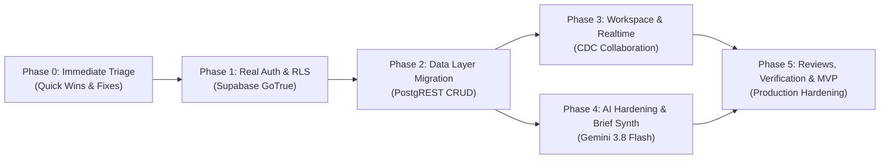

# SKILLBRIDGE FULL AUDIT: PRIORITIZED ROADMAP & IMPLEMENTATION PLAN
**Generated by**: EGM Swarm Synthesizer & Quality Gate  
**Scope**: Migration of `SkillBridge-Rework` from Demo Prototype to Production MVP  
**Estimated Effort**: 85 Engineering Hours (61 Story Points)  
**Audit Date**: November 17, 2026  

---

## 1. Prioritized Improvement Roadmap

The remediation strategy is organized into five strict sequential phases based on critical dependency chains:

---

## 2. Work Breakdown Structure (WBS) & Story Points

Estimation Scale:
- **S (Small)**: 1–3 Hours (3 Story Points)
- **M (Medium)**: 4–8 Hours (5 Story Points)
- **L (Large)**: 9–16 Hours (8 Story Points)
- **XL (Extra Large)**: 17–32 Hours (13 Story Points)

| Item ID | Phase | Component / Module | Scope & Actions | Effort | SP |
|:---:|:---:|:---|:---|:---:|:---:|
| **W-00** | **P0** | **Immediate Critical Bug Fixes** | 1. Fix demo switcher in `login.html` to match `auth.js`. 2. Persist new registrations to `SB_REGISTERED_USERS`. 3. Fix `p.skills` vs `p.required_skills` crash in search. 4. Fix category dropdown names on `projects.html`. 5. Fix `undefined` fields on `project-detail.html`. 6. Fix path resolution bug in `ai.js`. | **M** | 5 |
| **W-01** | **P0** | **XSS & Injection Sanitization** | Implement global `escapeHtml()` sanitizer; eliminate raw `.innerHTML` injections in notifications, chat, toast, and applicant cards. | **M** | 5 |
| **W-02** | **P1** | **Supabase GoTrue Auth Integration** | Replace mock `auth.js` with real `@supabase/supabase-js` v2 GoTrue auth (`signInWithPassword`, `signUp`, `signOut`, JWT session persistence). | **M** | 5 |
| **W-03** | **P1** | **Database Schema & RLS Completion** | 1. Link `public.users.id` to `auth.users(id)`. 2. Author missing RLS policies for 6 tables (`student_profiles`, `umkm_profiles`, `project_applications`, `notifications`, `reviews`, `audit_logs`). 3. Align case conventions (`STUDENT` vs `mahasiswa`). | **M** | 5 |
| **W-04** | **P2** | **Marketplace & Projects Data Layer** | Refactor `projects.html` and `project-detail.html` from `localStorage` to Supabase PostgREST queries; implement server-side search and filters. | **M** | 5 |
| **W-05** | **P2** | **Project Creation & Application Flow** | Wire `create-project.html` and 1-Click apply modal directly to PostgreSQL `projects` and `project_applications` tables. | **M** | 5 |
| **W-06** | **P2** | **Dynamic "My Projects" Binding** | Refactor `student/my-projects.html` and `umkm/my-projects.html` to dynamically render user-specific projects from database. | **M** | 5 |
| **W-07** | **P3** | **Automated Workspace & Tasks Engine** | On application acceptance, automatically insert row to `workspaces` and seed `project_tasks`; wire task checklist to database. | **L** | 8 |
| **W-08** | **P3** | **Real-Time Workspace Chat (CDC)** | Create `frontend/assets/js/chat.js`; subscribe to Supabase Realtime WebSocket channel on `messages` table for instant sync. | **M** | 5 |
| **W-09** | **P4** | **AI Brief Synthesizer (FR-04)** | Implement `/api/synthesize-brief` endpoint in `backend-ai` (FastAPI + Gemini 3.8 Flash prompt + Pydantic v2 schema); wire to `create-project.html`. | **M** | 5 |
| **W-10** | **P4** | **AI Microservice Security Hardening** | Restrict CORS whitelist (remove `*`); validate Supabase Bearer JWT tokens in FastAPI middleware; eliminate blocking sync SDK calls. | **S** | 3 |
| **W-11** | **P5** | **Two-Way Review & Portfolio Recalculation** | Wire `review.js` to `reviews` table; create "Selesaikan Proyek" trigger in workspace; update student `portfolio_score` dynamically. | **M** | 5 |
| **W-12** | **P5** | **Admin Governance & Audit Trail** | Wire `admin/verification.html`, `categories.html`, and `users.html` to real database; record actions in immutable `audit_logs`. | **M** | 5 |
| **W-13** | **P5** | **Design System & Shell Modularization** | Extract 16x duplicated sidebar into `assets/js/components/sidebar.js`; extract inline styles into `assets/css/pages/*.css`; remove `!important` dark theme overrides. | **L** | 8 |
| **TOTAL** | | **Comprehensive MVP Overhaul** | **14 Core Engineering Packages** | **~85 Hrs** | **74 SP** |

---

## 3. Detailed Phase-by-Phase Implementation Plan

### Phase 0: Immediate Quick Wins & Triage (Day 1)
- **Goal**: Resolve all functional breaking bugs within the existing prototype shell so demonstrations and evaluations run flawlessly without crashes.
- **Key Deliverables**:
  1. Synchronize `<select id="account-selector">` in `login.html` with `auth.js` preloaded accounts.
  2. Append new accounts to `SB_REGISTERED_USERS` on registration.
  3. Ensure `createProject` stores both `skills` and `required_skills` arrays.
  4. Fix category name matching between dropdown and seeded categories.
  5. Fix `undefined` category and location bindings in `project-detail.html`.
  6. Sanitize all dynamic HTML insertions with `escapeHtml()`.

### Phase 1: Authentication & Schema Hardening (Days 2–3) — BLOCKER
- **Goal**: Replace mock authentication with cryptographic Supabase GoTrue Auth and configure PostgreSQL RLS.
- **Key Deliverables**:
  1. Add `@supabase/supabase-js@2` via CDN script across all HTML headers.
  2. Implement Supabase Auth methods in `auth.js` (`signInWithPassword`, `signUp`, `signOut`, `getSession`).
  3. Update `supabase/schema.sql`: add missing RLS policies for all 12 tables and establish `users.id` foreign key referencing `auth.users(id)`.
  4. Apply schema migration to live Supabase project.

### Phase 2: Data Access Layer Migration (Days 4–5)
- **Goal**: Transition from `localStorage` to asynchronous PostgREST database queries.
- **Key Deliverables**:
  1. Refactor `SkillBridgeDB` methods in `supabase.js` to execute direct Supabase queries.
  2. Bind `projects.html` catalog to `public.projects` and `public.categories`.
  3. Bind `create-project.html` and application modals to database tables.
  4. Refactor `student/my-projects.html` and `umkm/my-projects.html` to render dynamic project cards.

### Phase 3: Workspace & Real-Time Collaboration (Days 6–7)
- **Goal**: Establish live collaboration workspaces with sub-300ms real-time messaging.
- **Key Deliverables**:
  1. Automate workspace generation when UMKM accepts an application.
  2. Connect sprint checklist in `workspace.html` to `public.project_tasks`.
  3. Create `frontend/assets/js/chat.js` subscribing to Supabase Realtime channel on `public.messages`.
  4. Provide role-aware navigation in `workspace.html` for both students and UMKM partners.

### Phase 4: AI Microservice Expansion & Hardening (Day 8)
- **Goal**: Fulfill SRS FR-04 and secure the FastAPI backend.
- **Key Deliverables**:
  1. Implement `POST /api/synthesize-brief` in `backend-ai/app/main.py`.
  2. Add AI synthesis button and modal to `create-project.html`.
  3. Enforce Supabase Bearer JWT authentication on AI endpoints.
  4. Restrict CORS whitelist to explicit development and production domains.
  5. Migrate synchronous SDK calls to asynchronous client (`client.aio`) to unblock event loop.

### Phase 5: Reviews, Governance & Production Polish (Days 9–10)
- **Goal**: Complete end-to-end lifecycle, verified reviews, administrative governance, and UI architecture modularization.
- **Key Deliverables**:
  1. Wire `review.js` to `public.reviews` and add "Selesaikan Proyek" action in workspace.
  2. Wire `admin/verification.html` and moderation actions to database and `audit_logs`.
  3. Extract duplicated sidebar into `components/sidebar.js`.
  4. Extract inline CSS into page stylesheets.
  5. Conduct final end-to-end integration test against IEEE 830 compliance checklist.

---

## 4. Technical Risk Register

| Risk ID | Risk Description | Severity | Likelihood | Mitigation Strategy |
|:---|:---|:---:|:---:|:---|
| **RSK-01** | **RLS Policy Lockout**: Incomplete RLS policies return empty arrays or 403 errors on client queries. | **CRITICAL** | High | Comprehensive RLS test suite verifying queries under `student`, `umkm`, and `anon` auth contexts before frontend switch. |
| **RSK-02** | **Gemini API 429 Quota Exhaustion**: Token depletion during live demonstrations locks out AI features. | **HIGH** | Medium | Maintain the existing intelligent heuristic fallback in `gemini_service.py`; implement in-memory LRU caching per skill hash. |
| **RSK-03** | **CORS Credential Rejections**: Browser blocks requests due to mismatched `allow_credentials` and wildcard origins. | **HIGH** | High | Remove wildcard `*` from `cors_origins`; specify explicit origin array (`http://localhost:3000`, `http://127.0.0.1:5500`). |
| **RSK-04** | **Browser Storage Eviction**: Users in Private/Incognito browsing lose all demo state unexpectedly. | **MEDIUM** | High | Complete Phase 1 and 2 migration to cloud Supabase PostgreSQL, eliminating client storage dependencies. |
| **RSK-05** | **File Upload Size & Type Vulnerabilities**: Users upload oversized or executable files as verification documents. | **HIGH** | Medium | Configure strict Supabase Storage bucket policies restricting MIME types to PDF/JPEG/PNG and enforcing 5MB max size. |
